<div align="center">

[中文](README.md) · [English](README.en.md) · [日本語](README.ja.md) · [한국어](README.ko.md)

<a href="https://ma1902056219-coder.github.io/openpixel/">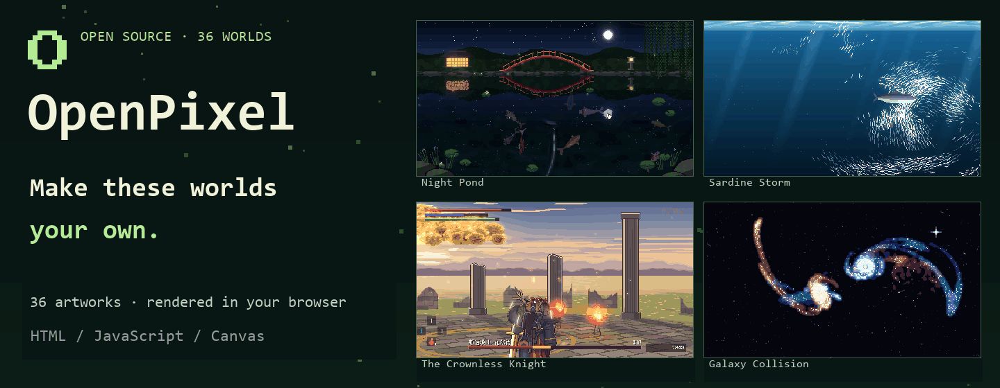</a>

# OpenPixel

**Make these pixel worlds your own.**

41 pixel experiments rendered in real time in your browser, from ripples on a pond to colliding galaxies.

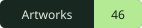  

[Download the collection](https://github.com/ma1902056219-coder/openpixel/archive/refs/heads/main.zip) · [Gallery](#gallery) · [Run locally](#start) · [Remix guide](docs/guide.en.md)


**[▶ Try all artworks online](https://ma1902056219-coder.github.io/openpixel/)**

</div>

## See them in motion

<div align="center">

</div>

Captured from the running artworks. Try any of the 41 works online, or download the source to make it your own.

- **Reach in:** feed koi, move a magnetic field, wipe frost and rake sand.
- **Watch it evolve:** moons form rings, fish avoid a dolphin and stars draw long tails.
- **Take over a scene:** a boss encounter, a sunset drive and a town that wakes up as a puzzle is assembled.
- **Edit the source:** each artwork has its own folder, source and instructions. No build step or AI API is required.

## Batch 04 · Five new pixel experiments

Turn 1,200 points of light into a whale, draw branching lightning, and blow iridescent bubbles. Explore light through a dewdrop and a rice-field image built for one viewpoint.

<table>
<tr>
<td width="33%" valign="top"><a href="https://ma1902056219-coder.github.io/openpixel/works/drone-light-show/">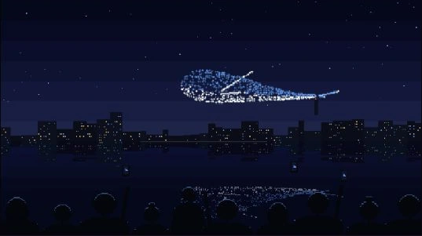<br><strong>Sky of a Thousand Lights</strong></a><br><sub>The same 1,200 lights become a globe, a whale, and a moon.</sub><br><a href="works/drone-light-show/source.js">Source</a> · <a href="docs/works.en.md#drone-light-show">Controls</a></td>
<td width="33%" valign="top"><a href="https://ma1902056219-coder.github.io/openpixel/works/storm-lightning/">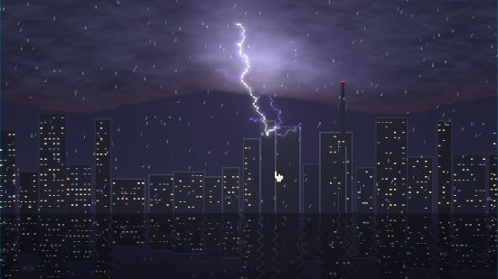<br><strong>Thunderstorm</strong></a><br><sub>Drag a path through the clouds to draw a branching bolt.</sub><br><a href="works/storm-lightning/source.js">Source</a> · <a href="docs/works.en.md#storm-lightning">Controls</a></td>
<td width="33%" valign="top"><a href="https://ma1902056219-coder.github.io/openpixel/works/soap-film/">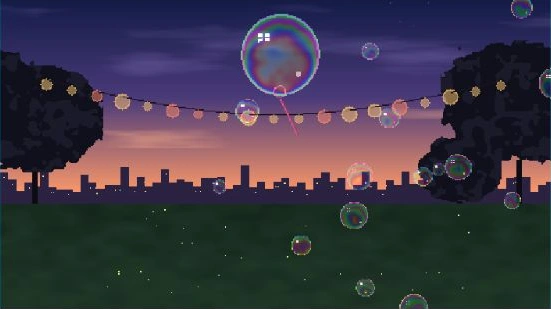<br><strong>Soap Film</strong></a><br><sub>Blow and pop bubbles whose colors change as the film thins.</sub><br><a href="works/soap-film/source.js">Source</a> · <a href="docs/works.en.md#soap-film">Controls</a></td>
</tr>
<tr>
<td width="33%" valign="top"><a href="https://ma1902056219-coder.github.io/openpixel/works/dewdrop-refraction/">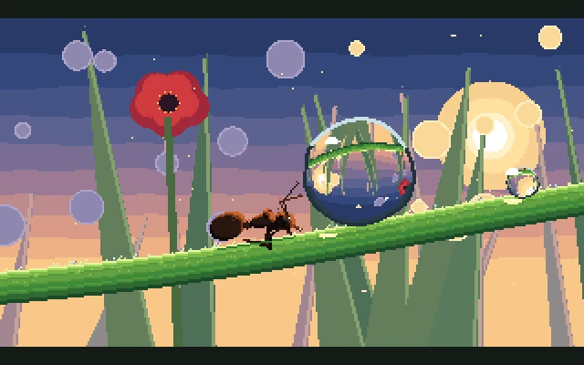<br><strong>One Drop of Dew</strong></a><br><sub>See a flower upside down through a droplet.</sub><br><a href="works/dewdrop-refraction/source.js">Source</a> · <a href="docs/works.en.md#dewdrop-refraction">Controls</a></td>
<td width="33%" valign="top"><a href="https://ma1902056219-coder.github.io/openpixel/works/rice-field-perspective/">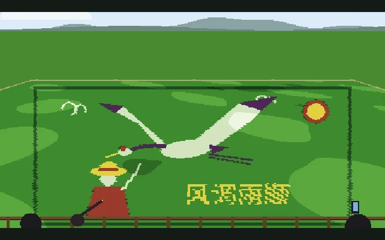<br><strong>Rice Field Art</strong></a><br><sub>Find the crane that only lines up from the viewing tower.</sub><br><a href="works/rice-field-perspective/source.js">Source</a> · <a href="docs/works.en.md#rice-field-perspective">Controls</a></td>
<td width="33%"></td>
</tr>
</table>

## Batch 03 · Five new pixel experiments

Make a waterfall move by cycling colors. Explore animated stitches, pinhole eclipses, rain music, and an ink-brush effect. Each runs on its own and includes editable source.

<table>
<tr>
<td width="33%" valign="top"><a href="https://ma1902056219-coder.github.io/openpixel/works/palette-waterfall/">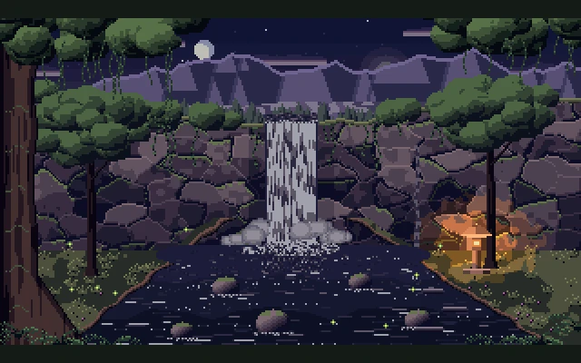<br><strong>Palette-Cycling Waterfall</strong></a><br><sub>Make the waterfall flow by cycling colors.</sub><br><a href="works/palette-waterfall/source.js">Source</a> · <a href="docs/works.en.md#palette-waterfall">Controls</a></td>
<td width="33%" valign="top"><a href="https://ma1902056219-coder.github.io/openpixel/works/living-knit/">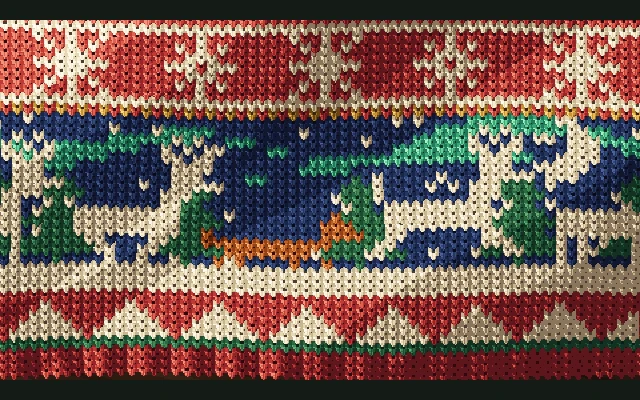<br><strong>Living Knit</strong></a><br><sub>A knitted landscape comes alive, until a cat pulls the yarn.</sub><br><a href="works/living-knit/source.js">Source</a> · <a href="docs/works.en.md#living-knit">Controls</a></td>
<td width="33%" valign="top"><a href="https://ma1902056219-coder.github.io/openpixel/works/pinhole-eclipse/">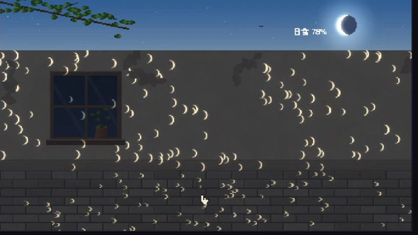<br><strong>Pinhole Eclipse</strong></a><br><sub>Move the Moon to turn the bright spots into crescents.</sub><br><a href="works/pinhole-eclipse/source.js">Source</a> · <a href="docs/works.en.md#pinhole-eclipse">Controls</a></td>
</tr>
<tr>
<td width="33%" valign="top"><a href="https://ma1902056219-coder.github.io/openpixel/works/rain-instrument/">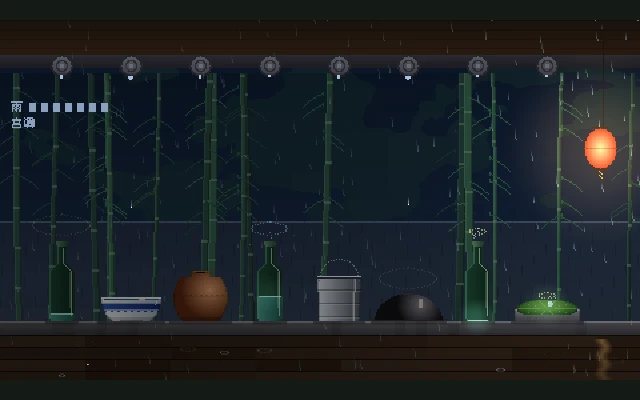<br><strong>Rain Instruments</strong></a><br><sub>Move bottles and bowls under the eaves to change the rhythm.</sub><br><a href="works/rain-instrument/source.js">Source</a> · <a href="docs/works.en.md#rain-instrument">Controls</a></td>
<td width="33%" valign="top"><a href="https://ma1902056219-coder.github.io/openpixel/works/ink-slash/">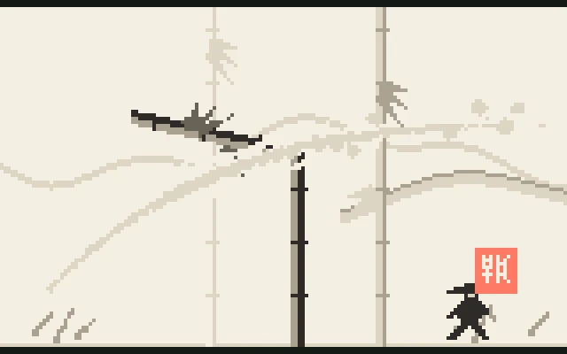<br><strong>Ink-Brush Slash</strong></a><br><sub>A dry ink stroke sweeps across the bamboo.</sub><br><a href="works/ink-slash/source.js">Source</a> · <a href="docs/works.en.md#ink-slash">Controls</a></td>
<td width="33%"></td>
</tr>
</table>

## Batch 02 · Five more experiments to remix

From molten sparks to seeds: each folder runs independently, with editable code and practical controls.

<table>
<tr>
<td width="33%" valign="top"><a href="https://ma1902056219-coder.github.io/openpixel/works/iron-flower/">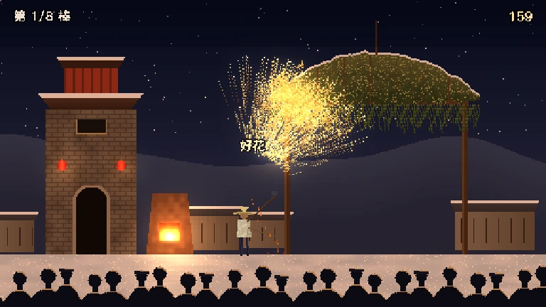<br><strong>Molten Iron Flowers</strong></a><br><sub>Strike molten iron into a shower of sparks that lights the village.</sub><br><a href="works/iron-flower/source.js">View source</a> · <a href="docs/works.en.md#iron-flower">Controls</a></td>
<td width="33%" valign="top"><a href="https://ma1902056219-coder.github.io/openpixel/works/watercolor/">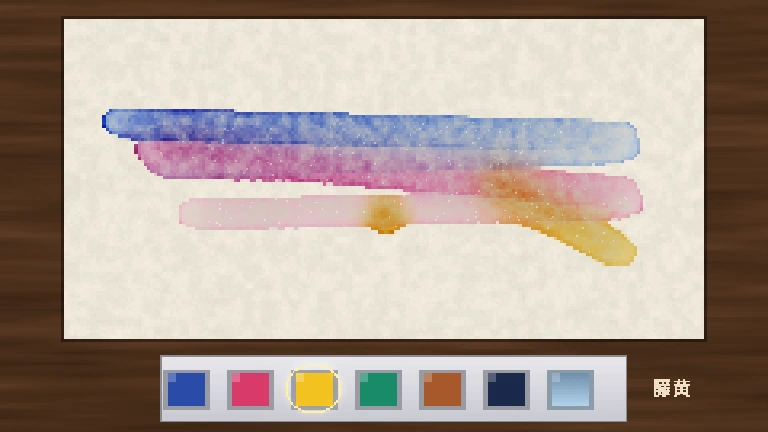<br><strong>Watercolor Bloom</strong></a><br><sub>Paint on wet paper and watch pigments spread and mix.</sub><br><a href="works/watercolor/source.js">View source</a> · <a href="docs/works.en.md#watercolor">Controls</a></td>
<td width="33%" valign="top"><a href="https://ma1902056219-coder.github.io/openpixel/works/coral-reef/">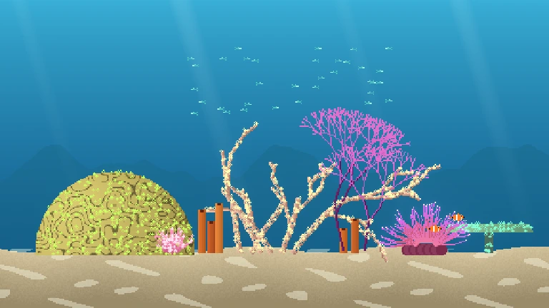<br><strong>Coral Reef</strong></a><br><sub>Touch coral, push a current and watch a small underwater ecosystem respond.</sub><br><a href="works/coral-reef/source.js">View source</a> · <a href="docs/works.en.md#coral-reef">Controls</a></td>
</tr>
<tr>
<td width="33%" valign="top"><a href="https://ma1902056219-coder.github.io/openpixel/works/dandelion/">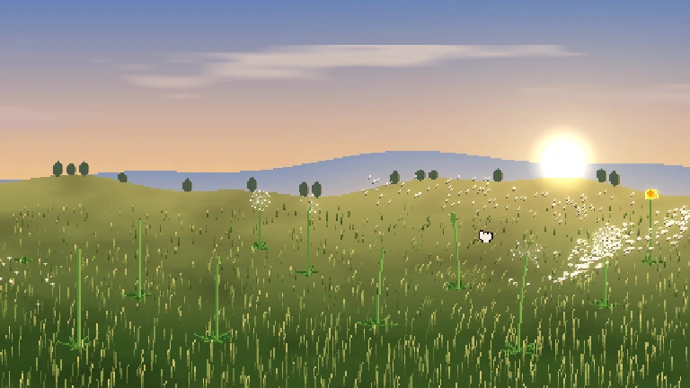<br><strong>Dandelion</strong></a><br><sub>Scatter seeds in the wind and watch new plants grow.</sub><br><a href="works/dandelion/source.js">View source</a> · <a href="docs/works.en.md#dandelion">Controls</a></td>
<td width="33%" valign="top"><a href="https://ma1902056219-coder.github.io/openpixel/works/kaleidoscope/">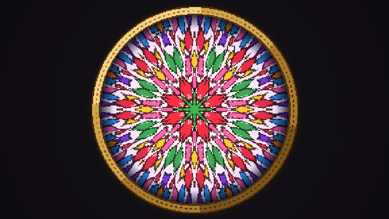<br><strong>Kaleidoscope</strong></a><br><sub>Turn colored fragments into changing mirrored patterns.</sub><br><a href="works/kaleidoscope/source.js">View source</a> · <a href="docs/works.en.md#kaleidoscope">Controls</a></td>
<td width="33%"></td>
</tr>
</table>

<a id="start"></a>

## Run locally

1. [Download and extract the collection](https://github.com/ma1902056219-coder/openpixel/archive/refs/heads/main.zip), or clone the repository.
2. Open the root `index.html`, or any `works/<artwork>/index.html`.
3. Watch the demonstration, then use the controls described on the page.

If your browser restricts local files, start a local server:

```bash
git clone https://github.com/ma1902056219-coder/openpixel.git
cd openpixel
python -m http.server 8080 --bind 127.0.0.1
```

Open [the local gallery](http://127.0.0.1:8080). Press `Ctrl+C` in the terminal to stop the server.

The README, remix guide and artwork controls are available in four languages. In-scene labels and source comments remain primarily Chinese. Desktop browsers with a keyboard and mouse provide the most complete experience; touch support varies by artwork.

<a id="gallery"></a>

## Gallery

Click a card to try the artwork online. Each work also links to controls and editable source; download the collection for offline use.

### Materials and interaction

<table>
<tr>
<td width="33%" valign="top"><a href="https://ma1902056219-coder.github.io/openpixel/works/night-pond/"><br><strong>Night Pond</strong></a><br><sub>Ripple the reflections and feed the koi.</sub><br><a href="works/night-pond/source.js">Source</a> · <a href="docs/works.en.md#night-pond">Controls</a></td>
<td width="33%" valign="top"><a href="https://ma1902056219-coder.github.io/openpixel/works/plasma-globe/"><br><strong>Plasma Globe</strong></a><br><sub>Gather electric arcs at your fingertip.</sub><br><a href="works/plasma-globe/source.js">Source</a> · <a href="docs/works.en.md#plasma-globe">Controls</a></td>
<td width="33%" valign="top"><a href="https://ma1902056219-coder.github.io/openpixel/works/chladni-plate/"><br><strong>Chladni Plate</strong></a><br><sub>Vibrations gather sand into changing patterns.</sub><br><a href="works/chladni-plate/source.js">Source</a> · <a href="docs/works.en.md#chladni-plate">Controls</a></td>
</tr>
<tr>
<td width="33%" valign="top"><a href="https://ma1902056219-coder.github.io/openpixel/works/ferrofluid/"><br><strong>Ferrofluid</strong></a><br><sub>Move a magnetic field to shape spikes and reflections.</sub><br><a href="works/ferrofluid/source.js">Source</a> · <a href="docs/works.en.md#ferrofluid">Controls</a></td>
<td width="33%" valign="top"><a href="https://ma1902056219-coder.github.io/openpixel/works/cracking-ice/"><br><strong>Cracking Ice</strong></a><br><sub>Pressure sends cracks across a frozen surface.</sub><br><a href="works/cracking-ice/source.js">Source</a> · <a href="docs/works.en.md#cracking-ice">Controls</a></td>
<td width="33%" valign="top"><a href="https://ma1902056219-coder.github.io/openpixel/works/frost-window/"><br><strong>Frosted Window</strong></a><br><sub>Wipe frost away and watch it grow back.</sub><br><a href="works/frost-window/source.js">Source</a> · <a href="docs/works.en.md#frost-window">Controls</a></td>
</tr>
<tr>
<td width="33%" valign="top"><a href="https://ma1902056219-coder.github.io/openpixel/works/zen-garden/"><br><strong>Zen Garden</strong></a><br><sub>Rake sand and change the light and weather.</sub><br><a href="works/zen-garden/source.js">Source</a> · <a href="docs/works.en.md#zen-garden">Controls</a></td>
<td width="33%" valign="top"><a href="https://ma1902056219-coder.github.io/openpixel/works/pottery/"><br><strong>Pottery Wheel</strong></a><br><sub>Shape clay on a spinning wheel.</sub><br><a href="works/pottery/source.js">Source</a> · <a href="docs/works.en.md#pottery">Controls</a></td>
<td width="33%" valign="top"><a href="https://ma1902056219-coder.github.io/openpixel/works/kintsugi/"><br><strong>Kintsugi</strong></a><br><sub>Reassemble broken pottery, then lacquer, gild and polish it.</sub><br><a href="works/kintsugi/source.js">Source</a> · <a href="docs/works.en.md#kintsugi">Controls</a></td>
</tr>
<tr>
<td width="33%" valign="top"><a href="https://ma1902056219-coder.github.io/openpixel/works/light-painting/"><br><strong>Light Painting</strong></a><br><sub>Build trails, spirals and glowing layers of light.</sub><br><a href="works/light-painting/source.js">Source</a> · <a href="docs/works.en.md#light-painting">Controls</a></td>
<td width="33%"></td>
<td width="33%"></td>
</tr>
</table>

### Nature and cosmos

<table>
<tr>
<td width="33%" valign="top"><a href="https://ma1902056219-coder.github.io/openpixel/works/sardine-storm/"><br><strong>Sardine Storm</strong></a><br><sub>Guide a dolphin through a swirling school of fish.</sub><br><a href="works/sardine-storm/source.js">Source</a> · <a href="docs/works.en.md#sardine-storm">Controls</a></td>
<td width="33%" valign="top"><a href="https://ma1902056219-coder.github.io/openpixel/works/jellyfish/"><br><strong>Jellyfish</strong></a><br><sub>Translucent bodies, soft tentacles and a chain of light.</sub><br><a href="works/jellyfish/source.js">Source</a> · <a href="docs/works.en.md#jellyfish">Controls</a></td>
<td width="33%" valign="top"><a href="https://ma1902056219-coder.github.io/openpixel/works/saturn-rings/"><br><strong>Saturn&#x27;s Rings</strong></a><br><sub>Launch moons and watch them break into rings.</sub><br><a href="works/saturn-rings/source.js">Source</a> · <a href="docs/works.en.md#saturn-rings">Controls</a></td>
</tr>
<tr>
<td width="33%" valign="top"><a href="https://ma1902056219-coder.github.io/openpixel/works/galaxy-collision/"><br><strong>Galaxy Collision</strong></a><br><sub>Two galaxies draw long tidal tails as they meet.</sub><br><a href="works/galaxy-collision/source.js">Source</a> · <a href="docs/works.en.md#galaxy-collision">Controls</a></td>
<td width="33%" valign="top"><a href="https://ma1902056219-coder.github.io/openpixel/works/black-hole/"><br><strong>Black Hole</strong></a><br><sub>An accretion disk, lensing and moving starlight.</sub><br><a href="works/black-hole/source.js">Source</a> · <a href="docs/works.en.md#black-hole">Controls</a></td>
<td width="33%" valign="top"><a href="https://ma1902056219-coder.github.io/openpixel/works/solar-limb/"><br><strong>Solar Limb</strong></a><br><sub>Prominences, solar granules and Earth shown for scale.</sub><br><a href="works/solar-limb/source.js">Source</a> · <a href="docs/works.en.md#solar-limb">Controls</a></td>
</tr>
<tr>
<td width="33%" valign="top"><a href="https://ma1902056219-coder.github.io/openpixel/works/aurora/"><br><strong>Aurora</strong></a><br><sub>Curtains of light over snow, a cabin and reflected water.</sub><br><a href="works/aurora/source.js">Source</a> · <a href="docs/works.en.md#aurora">Controls</a></td>
<td width="33%"></td>
<td width="33%"></td>
</tr>
</table>

### Space and illusions

<table>
<tr>
<td width="33%" valign="top"><a href="https://ma1902056219-coder.github.io/openpixel/works/endless-window/"><br><strong>Endless Window</strong></a><br><sub>Six nested worlds lead back to the beginning.</sub><br><a href="works/endless-window/source.js">Source</a> · <a href="docs/works.en.md#endless-window">Controls</a></td>
<td width="33%" valign="top"><a href="https://ma1902056219-coder.github.io/openpixel/works/penrose-tower/"><br><strong>Endless Ascent</strong></a><br><sub>Rotate the view to reveal an impossible staircase.</sub><br><a href="works/penrose-tower/source.js">Source</a> · <a href="docs/works.en.md#penrose-tower">Controls</a></td>
<td width="33%" valign="top"><a href="https://ma1902056219-coder.github.io/openpixel/works/living-jigsaw/"><br><strong>Living Jigsaw</strong></a><br><sub>Assembled pieces come alive; the bus waits for the final piece.</sub><br><a href="works/living-jigsaw/source.js">Source</a> · <a href="docs/works.en.md#living-jigsaw">Controls</a></td>
</tr>
<tr>
<td width="33%" valign="top"><a href="https://ma1902056219-coder.github.io/openpixel/works/ocean-in-a-tank/"><br><strong>Ocean in a Tank</strong></a><br><sub>A desk-sized aquarium hides a much larger sea.</sub><br><a href="works/ocean-in-a-tank/source.js">Source</a> · <a href="docs/works.en.md#ocean-in-a-tank">Controls</a></td>
<td width="33%"></td>
<td width="33%"></td>
</tr>
</table>

### Playable scenes

<table>
<tr>
<td width="33%" valign="top"><a href="https://ma1902056219-coder.github.io/openpixel/works/crown-knight/"><br><strong>The Crownless Knight</strong></a><br><sub>A boss encounter with dodges, stagger and changing camera angles.</sub><br><a href="works/crown-knight/source.js">Source</a> · <a href="docs/works.en.md#crown-knight">Controls</a></td>
<td width="33%" valign="top"><a href="https://ma1902056219-coder.github.io/openpixel/works/sunset-loop/"><br><strong>Sunset Loop</strong></a><br><sub>Drive toward the sunset with a rear-view camera.</sub><br><a href="works/sunset-loop/source.js">Source</a> · <a href="docs/works.en.md#sunset-loop">Controls</a></td>
<td width="33%"></td>
</tr>
</table>

### Pixel landscapes

<table>
<tr>
<td width="33%" valign="top"><a href="https://ma1902056219-coder.github.io/openpixel/works/thousand-li/"><br><strong>A Thousand Li of Rivers and Mountains</strong></a><br><sub>A moving blue-green landscape scroll.</sub><br><a href="works/thousand-li/source.js">Source</a> · <a href="docs/works.en.md#thousand-li">Controls</a></td>
<td width="33%" valign="top"><a href="https://ma1902056219-coder.github.io/openpixel/works/rainbow-bridge/"><br><strong>Qingming Scroll: Rainbow Bridge</strong></a><br><sub>Boats, vendors and pedestrians bring a scroll to life.</sub><br><a href="works/rainbow-bridge/source.js">Source</a> · <a href="docs/works.en.md#rainbow-bridge">Controls</a></td>
<td width="33%" valign="top"><a href="https://ma1902056219-coder.github.io/openpixel/works/rose-window/"><br><strong>Gothic Rose Window</strong></a><br><sub>Colored glass casts shifting patterns across a cathedral floor.</sub><br><a href="works/rose-window/source.js">Source</a> · <a href="docs/works.en.md#rose-window">Controls</a></td>
</tr>
</table>

## Make your own version

Copy one complete artwork folder, edit `source.js`, then refresh the running page. Change one color or parameter first, and check both the demonstration and manual controls.

The original project was made with Claude-assisted programming. You can also give a complete folder and a specific request to GPT, Gemini or another coding assistant. Always run and check the result. See the [remix guide](docs/guide.en.md) for examples.

```text
Read source.js and identify initialization, per-frame updates and drawing.
Change the night palette into sunset colors while preserving the controls.
Explain the changes first; do not add external images, services or dependencies.
```

## Project layout

Each `works/<slug>/` folder includes `index.html`, `source.js`, a read-only `source.html`, `poster.webp`, a Chinese `README.md` and a copy of `LICENSE`. Translated [artwork controls](docs/works.en.md) explain how to interact with every scene. Shared runtime code is included in each folder so it can be copied independently.

These are pixel-art and small gameplay experiments. Combat and driving retain simplified prototype rules. System fonts and random processes can produce differences between runs.

## Updates and contributions

The collection now includes 41 artworks across four batches. More effects will be shared from time to time. Improvements to interaction, visuals and performance are welcome. For issues, include the artwork name, browser and steps to reproduce. For a pull request, explain your change and check both demo and manual modes. See [CONTRIBUTING.md](CONTRIBUTING.md) for the original Chinese guidelines.

## Author and license

Curated and maintained by **喵老弟 [@MarkMFFF](https://x.com/MarkMFFF)**. Follow for demos, experiments and future batches.

Code is available under the [MIT License](LICENSE); retain the copyright and license text when reusing it. Style references do not imply affiliation with commercial games or brands. Original file fingerprints and extraction notes are recorded in [SOURCE_NOTES.md](SOURCE_NOTES.md).
