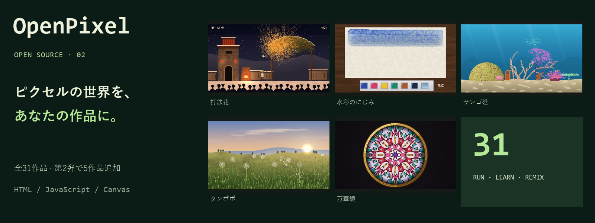
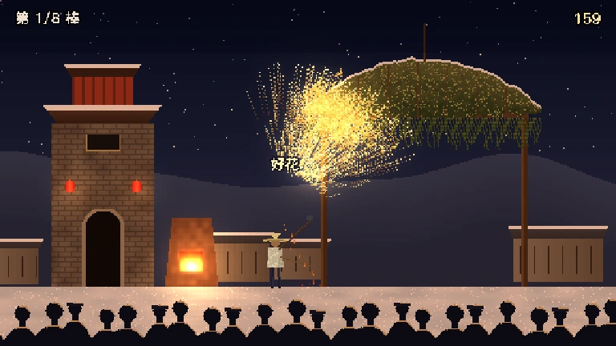
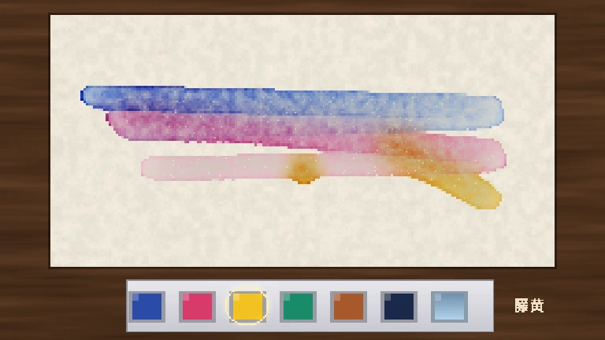
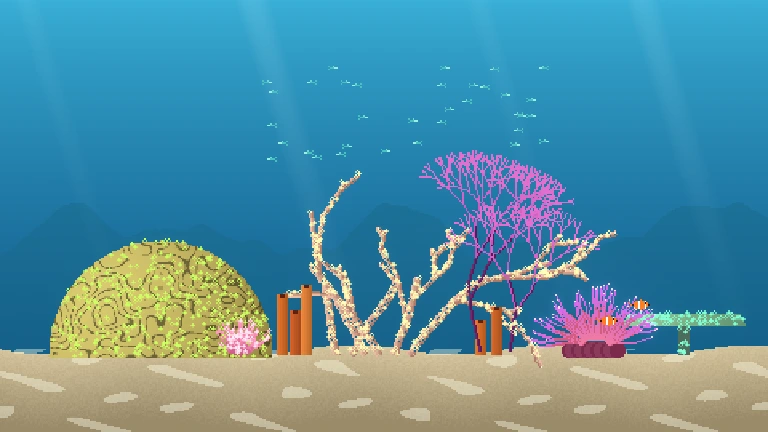
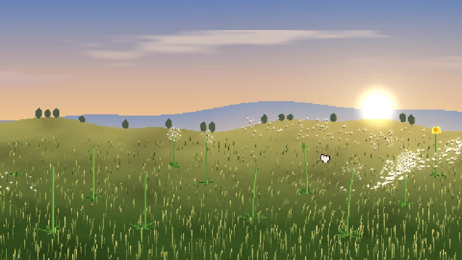
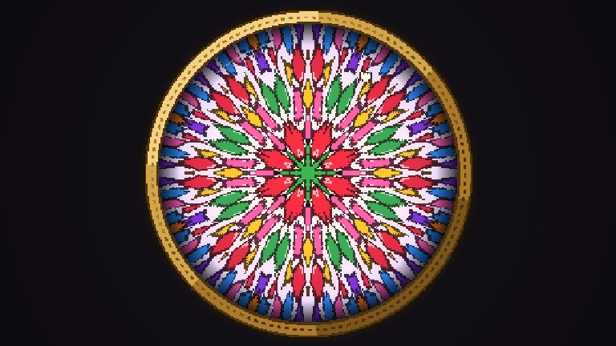
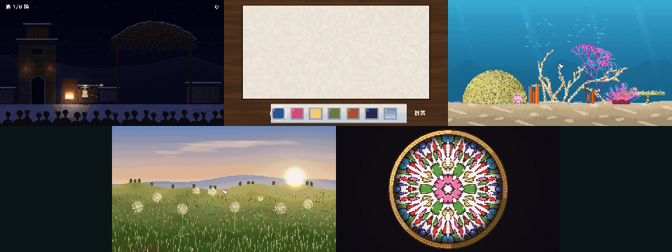

<div align="center">

[中文](README.md) · [English](README.en.md) · [日本語](README.ja.md) · [한국어](README.ko.md)



# OpenPixel

**ピクセルの世界を、あなたの作品に。**

池の波紋から銀河の衝突まで。ブラウザでリアルタイムに描画する、31 のピクセル実験です。

  

[作品集をダウンロード](https://github.com/ma1902056219-coder/openpixel/archive/refs/heads/main.zip) · [作品一覧](#gallery) · [ローカルで動かす](#start) · [改造ガイド](docs/guide.ja.md)


**[▶ 全作品をオンラインで体験](https://ma1902056219-coder.github.io/openpixel/)**

</div>

## 第2弾 · 改造して学べる5つの実験

鉄の火花からタンポポの種まで。各フォルダーで独立実行でき、編集用コードと操作説明が付いています。

<table>
<tr>
<td width="33%" valign="top"><a href="https://ma1902056219-coder.github.io/openpixel/works/iron-flower/"><br><strong>打鉄花</strong></a><br><sub>溶けた鉄を打ち上げ、村を照らす金色の火花に。</sub><br><a href="works/iron-flower/source.js">ソースを見る</a> · <a href="docs/works.ja.md#iron-flower">操作説明</a></td>
<td width="33%" valign="top"><a href="https://ma1902056219-coder.github.io/openpixel/works/watercolor/"><br><strong>水彩のにじみ</strong></a><br><sub>濡れた紙で絵の具が広がり、混ざり合う。</sub><br><a href="works/watercolor/source.js">ソースを見る</a> · <a href="docs/works.ja.md#watercolor">操作説明</a></td>
<td width="33%" valign="top"><a href="https://ma1902056219-coder.github.io/openpixel/works/coral-reef/"><br><strong>サンゴ礁</strong></a><br><sub>サンゴへのタッチや水流に、小さな海の世界が反応する。</sub><br><a href="works/coral-reef/source.js">ソースを見る</a> · <a href="docs/works.ja.md#coral-reef">操作説明</a></td>
</tr>
<tr>
<td width="33%" valign="top"><a href="https://ma1902056219-coder.github.io/openpixel/works/dandelion/"><br><strong>タンポポ</strong></a><br><sub>綿毛を飛ばし、落ちた種から新しい株を育てる。</sub><br><a href="works/dandelion/source.js">ソースを見る</a> · <a href="docs/works.ja.md#dandelion">操作説明</a></td>
<td width="33%" valign="top"><a href="https://ma1902056219-coder.github.io/openpixel/works/kaleidoscope/"><br><strong>万華鏡</strong></a><br><sub>鏡筒を回すたび、色のかけらが新しい模様になる。</sub><br><a href="works/kaleidoscope/source.js">ソースを見る</a> · <a href="docs/works.ja.md#kaleidoscope">操作説明</a></td>
<td width="33%"></td>
</tr>
</table>


## まずは動く様子を

<div align="center">

</div>

今回追加した5作品の実際の実行映像です。初回の26作品を含め、現在は全31作品です。

- **触ってみる：** 錦鯉に餌をあげ、磁場を動かし、霜を拭い、砂紋を描けます。
- **変化を眺める：** 衛星が環になり、魚群がイルカを避け、星の軌跡が長い尾になります。
- **場面に入り込む：** ボス戦、夕暮れのドライブ、パズルがはまると動き出す町。
- **ソースを改造する：** 作品ごとに独立したフォルダー、ソース、説明を用意。ビルドや AI API は不要です。

<a id="start"></a>

## ローカルで動かす

1. [作品集をダウンロードして解凍](https://github.com/ma1902056219-coder/openpixel/archive/refs/heads/main.zip)するか、リポジトリを clone します。
2. ルートの `index.html`、または `works/<作品名>/index.html` を開きます。
3. デモを眺めてから、各ページの操作説明に沿って遊んでください。

ローカルファイルがブラウザで制限される場合は、ローカルサーバーを起動します。

```bash
git clone https://github.com/ma1902056219-coder/openpixel.git
cd openpixel
python -m http.server 8080 --bind 127.0.0.1
```

[ローカルの作品集](http://127.0.0.1:8080)を開いてください。終了するときはターミナルで `Ctrl+C` を押します。

README、改造ガイド、作品の操作説明は4言語で読めます。作品内の表示とソースコメントは主に中国語です。キーボードとマウスを使うデスクトップブラウザを推奨します。タッチ操作への対応は作品ごとに異なります。

<a id="gallery"></a>

## 作品一覧

図をクリックするとブラウザーで直接体験できます。操作説明とソースも付属し、ダウンロードしてオフラインでも実行できます。

### 触れて遊ぶ・質感

<table>
<tr>
<td width="33%" valign="top"><a href="https://ma1902056219-coder.github.io/openpixel/works/night-pond/"><br><strong>夜の池</strong></a><br><sub>波紋で映り込みを揺らし、錦鯉に餌をあげる。</sub><br><a href="works/night-pond/source.js">ソースを見る</a> · <a href="docs/works.ja.md#night-pond">操作説明</a></td>
<td width="33%" valign="top"><a href="https://ma1902056219-coder.github.io/openpixel/works/plasma-globe/"><br><strong>プラズマボール</strong></a><br><sub>指先へ電光を集めて動かす。</sub><br><a href="works/plasma-globe/source.js">ソースを見る</a> · <a href="docs/works.ja.md#plasma-globe">操作説明</a></td>
<td width="33%" valign="top"><a href="https://ma1902056219-coder.github.io/openpixel/works/chladni-plate/"><br><strong>クラドニ図形</strong></a><br><sub>振動に合わせて、砂がさまざまな模様に集まる。</sub><br><a href="works/chladni-plate/source.js">ソースを見る</a> · <a href="docs/works.ja.md#chladni-plate">操作説明</a></td>
</tr>
<tr>
<td width="33%" valign="top"><a href="https://ma1902056219-coder.github.io/openpixel/works/ferrofluid/"><br><strong>磁性流体</strong></a><br><sub>磁場を動かして、液体の突起と反射を変える。</sub><br><a href="works/ferrofluid/source.js">ソースを見る</a> · <a href="docs/works.ja.md#ferrofluid">操作説明</a></td>
<td width="33%" valign="top"><a href="https://ma1902056219-coder.github.io/openpixel/works/cracking-ice/"><br><strong>氷の亀裂</strong></a><br><sub>力を加えると、凍った表面に亀裂が広がる。</sub><br><a href="works/cracking-ice/source.js">ソースを見る</a> · <a href="docs/works.ja.md#cracking-ice">操作説明</a></td>
<td width="33%" valign="top"><a href="https://ma1902056219-coder.github.io/openpixel/works/frost-window/"><br><strong>霜の窓</strong></a><br><sub>指で霜を拭い、再び育つ様子を眺める。</sub><br><a href="works/frost-window/source.js">ソースを見る</a> · <a href="docs/works.ja.md#frost-window">操作説明</a></td>
</tr>
<tr>
<td width="33%" valign="top"><a href="https://ma1902056219-coder.github.io/openpixel/works/zen-garden/"><br><strong>枯山水</strong></a><br><sub>砂紋を描き、時間帯と天気を変える。</sub><br><a href="works/zen-garden/source.js">ソースを見る</a> · <a href="docs/works.ja.md#zen-garden">操作説明</a></td>
<td width="33%" valign="top"><a href="https://ma1902056219-coder.github.io/openpixel/works/pottery/"><br><strong>ろくろ</strong></a><br><sub>回るろくろの上で、粘土の形を整える。</sub><br><a href="works/pottery/source.js">ソースを見る</a> · <a href="docs/works.ja.md#pottery">操作説明</a></td>
<td width="33%" valign="top"><a href="https://ma1902056219-coder.github.io/openpixel/works/kintsugi/"><br><strong>金継ぎ</strong></a><br><sub>欠片を合わせ、漆、金粉、磨きの工程を進める。</sub><br><a href="works/kintsugi/source.js">ソースを見る</a> · <a href="docs/works.ja.md#kintsugi">操作説明</a></td>
</tr>
<tr>
<td width="33%" valign="top"><a href="https://ma1902056219-coder.github.io/openpixel/works/light-painting/"><br><strong>光のペインティング</strong></a><br><sub>光跡を重ね、渦や光の層を描く。</sub><br><a href="works/light-painting/source.js">ソースを見る</a> · <a href="docs/works.ja.md#light-painting">操作説明</a></td>
<td width="33%"></td>
<td width="33%"></td>
</tr>
</table>

### 自然と宇宙

<table>
<tr>
<td width="33%" valign="top"><a href="https://ma1902056219-coder.github.io/openpixel/works/sardine-storm/"><br><strong>イワシの嵐</strong></a><br><sub>イルカを動かして、渦を巻く魚群をかき分ける。</sub><br><a href="works/sardine-storm/source.js">ソースを見る</a> · <a href="docs/works.ja.md#sardine-storm">操作説明</a></td>
<td width="33%" valign="top"><a href="https://ma1902056219-coder.github.io/openpixel/works/jellyfish/"><br><strong>クラゲ</strong></a><br><sub>透ける傘、柔らかな触手、触れると広がる光。</sub><br><a href="works/jellyfish/source.js">ソースを見る</a> · <a href="docs/works.ja.md#jellyfish">操作説明</a></td>
<td width="33%" valign="top"><a href="https://ma1902056219-coder.github.io/openpixel/works/saturn-rings/"><br><strong>土星の環</strong></a><br><sub>衛星を投げ込み、砕けて環になる様子を眺める。</sub><br><a href="works/saturn-rings/source.js">ソースを見る</a> · <a href="docs/works.ja.md#saturn-rings">操作説明</a></td>
</tr>
<tr>
<td width="33%" valign="top"><a href="https://ma1902056219-coder.github.io/openpixel/works/galaxy-collision/"><br><strong>銀河の衝突</strong></a><br><sub>二つの銀河が接近し、星の軌跡が長い尾になる。</sub><br><a href="works/galaxy-collision/source.js">ソースを見る</a> · <a href="docs/works.ja.md#galaxy-collision">操作説明</a></td>
<td width="33%" valign="top"><a href="https://ma1902056219-coder.github.io/openpixel/works/black-hole/"><br><strong>ブラックホール</strong></a><br><sub>降着円盤とレンズ効果、背景の星の変化。</sub><br><a href="works/black-hole/source.js">ソースを見る</a> · <a href="docs/works.ja.md#black-hole">操作説明</a></td>
<td width="33%" valign="top"><a href="https://ma1902056219-coder.github.io/openpixel/works/solar-limb/"><br><strong>太陽の縁</strong></a><br><sub>プロミネンス、粒状斑、比較用の小さな地球。</sub><br><a href="works/solar-limb/source.js">ソースを見る</a> · <a href="docs/works.ja.md#solar-limb">操作説明</a></td>
</tr>
<tr>
<td width="33%" valign="top"><a href="https://ma1902056219-coder.github.io/openpixel/works/aurora/"><br><strong>オーロラ</strong></a><br><sub>雪山と小屋、水面の上に揺れる光のカーテン。</sub><br><a href="works/aurora/source.js">ソースを見る</a> · <a href="docs/works.ja.md#aurora">操作説明</a></td>
<td width="33%"></td>
<td width="33%"></td>
</tr>
</table>

### 空間と錯覚

<table>
<tr>
<td width="33%" valign="top"><a href="https://ma1902056219-coder.github.io/openpixel/works/endless-window/"><br><strong>無限の窓</strong></a><br><sub>六つの世界が入れ子になり、最初の景色へ戻る。</sub><br><a href="works/endless-window/source.js">ソースを見る</a> · <a href="docs/works.ja.md#endless-window">操作説明</a></td>
<td width="33%" valign="top"><a href="https://ma1902056219-coder.github.io/openpixel/works/penrose-tower/"><br><strong>終わらない階段</strong></a><br><sub>視点を回し、不可能な階段の仕組みを確かめる。</sub><br><a href="works/penrose-tower/source.js">ソースを見る</a> · <a href="docs/works.ja.md#penrose-tower">操作説明</a></td>
<td width="33%" valign="top"><a href="https://ma1902056219-coder.github.io/openpixel/works/living-jigsaw/"><br><strong>動き出すパズル</strong></a><br><sub>はまったピースが動き出し、最後の一片でバスが走る。</sub><br><a href="works/living-jigsaw/source.js">ソースを見る</a> · <a href="docs/works.ja.md#living-jigsaw">操作説明</a></td>
</tr>
<tr>
<td width="33%" valign="top"><a href="https://ma1902056219-coder.github.io/openpixel/works/ocean-in-a-tank/"><br><strong>水槽の中の海</strong></a><br><sub>机の上の小さな水槽に、広い海が隠れている。</sub><br><a href="works/ocean-in-a-tank/source.js">ソースを見る</a> · <a href="docs/works.ja.md#ocean-in-a-tank">操作説明</a></td>
<td width="33%"></td>
<td width="33%"></td>
</tr>
</table>

### 遊べるシーン

<table>
<tr>
<td width="33%" valign="top"><a href="https://ma1902056219-coder.github.io/openpixel/works/crown-knight/"><br><strong>失冠の騎士</strong></a><br><sub>回避、体勢崩し、視点切り替えのあるボス戦。</sub><br><a href="works/crown-knight/source.js">ソースを見る</a> · <a href="docs/works.ja.md#crown-knight">操作説明</a></td>
<td width="33%" valign="top"><a href="https://ma1902056219-coder.github.io/openpixel/works/sunset-loop/"><br><strong>サンセット・ループ</strong></a><br><sub>夕日へ向かって走る、後方視点のドライブ。</sub><br><a href="works/sunset-loop/source.js">ソースを見る</a> · <a href="docs/works.ja.md#sunset-loop">操作説明</a></td>
<td width="33%"></td>
</tr>
</table>

### ピクセルの画巻

<table>
<tr>
<td width="33%" valign="top"><a href="https://ma1902056219-coder.github.io/openpixel/works/thousand-li/"><br><strong>千里江山</strong></a><br><sub>青と緑の山水画が、動く絵巻として広がる。</sub><br><a href="works/thousand-li/source.js">ソースを見る</a> · <a href="docs/works.ja.md#thousand-li">操作説明</a></td>
<td width="33%" valign="top"><a href="https://ma1902056219-coder.github.io/openpixel/works/rainbow-bridge/"><br><strong>清明上河図・虹橋</strong></a><br><sub>船、露店、人々が行き交う小さな絵巻。</sub><br><a href="works/rainbow-bridge/source.js">ソースを見る</a> · <a href="docs/works.ja.md#rainbow-bridge">操作説明</a></td>
<td width="33%" valign="top"><a href="https://ma1902056219-coder.github.io/openpixel/works/rose-window/"><br><strong>ゴシックのバラ窓</strong></a><br><sub>ステンドグラスの光が、大聖堂の床をゆっくり移る。</sub><br><a href="works/rose-window/source.js">ソースを見る</a> · <a href="docs/works.ja.md#rose-window">操作説明</a></td>
</tr>
</table>

## 自分の作品に変えてみる

作品のフォルダーを丸ごとコピーし、`source.js` を編集してページを再読み込みします。まずは色や数値を一つだけ変更し、デモと手動操作の両方を確認してください。

原プロジェクトは Claude の支援を受けてプログラミングしました。フォルダー全体と具体的な依頼を GPT、Gemini などのコーディング支援ツールへ渡して、改造を試すこともできます。変更後は必ず実際に動かして確認してください。詳しくは[改造ガイド](docs/guide.ja.md)へ。

```text
source.js を読み、初期化、フレーム更新、描画の処理を特定してください。
操作を維持したまま、夜景の配色を夕暮れの色へ変えてください。
変更箇所を先に説明し、外部画像・サービス・依存関係は追加しないでください。
```

## ファイル構成

各 `works/<slug>/` に `index.html`、`source.js`、読み取り用の `source.html`、`poster.webp`、中国語の `README.md`、`LICENSE` があります。[日本語の操作説明](docs/works.ja.md)から各作品の使い方を確認できます。フォルダー単位でコピーできるよう、共通の実行コードも各作品に含めています。

これらはピクセルアートや小さなゲームプレイの実験です。戦闘とドライブは簡略化したプロトタイプのルールを使っています。システムフォントや乱数により、表示が変わることがあります。

## 更新と参加

2回の公開で、現在は全31作品です。今後も新しい表現を不定期に公開する予定です。操作性、見た目、パフォーマンスの改善を歓迎します。問題の報告には作品名、ブラウザ、再現手順を記載してください。Pull Request には変更内容と、デモ・手動操作の確認結果を添えてください。原文の参加案内は [CONTRIBUTING.md](CONTRIBUTING.md) にあります。

## 作者とライセンス

**喵老弟 [@MarkMFFF](https://x.com/MarkMFFF)** が整理・保守しています。作品のデモ、制作の試行錯誤、次回の公開情報は X でも発信します。

コードは [MIT License](LICENSE) で公開しています。再利用時は著作権表示とライセンス文を残してください。作風の参考は、商用ゲームやブランドとの提携を示すものではありません。元ファイルのハッシュと整理記録は [SOURCE_NOTES.md](SOURCE_NOTES.md) にあります。
