<div align="center">

[中文](README.md) · [English](README.en.md) · [日本語](README.ja.md) · [한국어](README.ko.md)

<a href="https://ma1902056219-coder.github.io/openpixel/">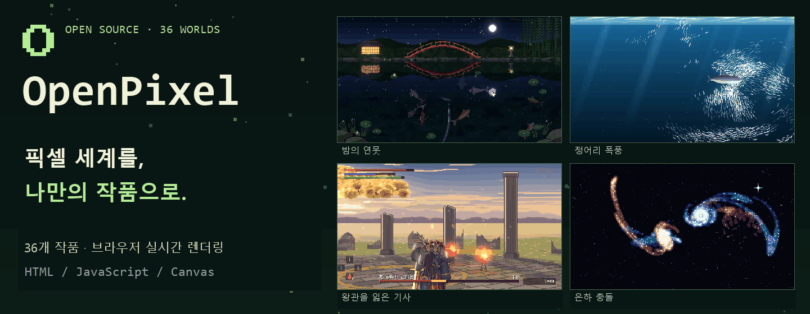</a>

# OpenPixel

**픽셀 세계를 나만의 작품으로.**

연못의 물결부터 은하 충돌까지, 브라우저에서 실시간으로 그리는 46개의 픽셀 실험입니다.

  

[작품 모음 다운로드](https://github.com/ma1902056219-coder/openpixel/archive/refs/heads/main.zip) · [작품 목록](#gallery) · [로컬에서 실행하기](#start) · [수정 가이드](docs/guide.ko.md)


**[▶ 모든 작품 온라인 체험](https://ma1902056219-coder.github.io/openpixel/)**

</div>

## 움직이는 모습부터 살펴보세요

<div align="center">

</div>

실제로 실행한 작품 화면입니다. 46개 작품을 온라인으로 체험하거나 소스를 다운로드해 나만의 작품으로 바꿔 보세요.

- **직접 만져보기:** 비단잉어에게 먹이를 주고, 자기장을 움직이고, 성에를 닦고, 모래에 무늬를 남겨 보세요.
- **변화 관찰하기:** 위성은 고리가 되고, 물고기는 돌고래를 피하며, 별의 궤적은 긴 꼬리를 만듭니다.
- **장면 속으로 들어가기:** 보스 전투, 노을 속 드라이브, 퍼즐을 맞추면 움직이는 마을.
- **소스 수정하기:** 작품마다 독립 폴더, 소스 코드, 설명을 제공합니다. 빌드나 AI API가 필요하지 않습니다.

## 다섯 번째 공개 · 픽셀 실험 5개

물웅덩이를 지나 다른 거리로 가 보세요. 성을 짊어진 거상, 형광 스프레이, 종소리, 역의 기계식 전광판도 각각 실행할 수 있습니다.

<table>
<tr>
<td width="33%" valign="top"><a href="https://ma1902056219-coder.github.io/openpixel/works/puddle-worlds/">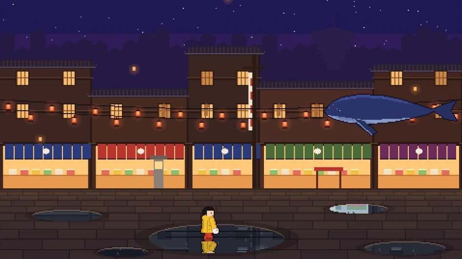<br><strong>웅덩이 너머</strong></a><br><sub>물웅덩이에 비친 다른 거리로 넘어갑니다.</sub><br><a href="works/puddle-worlds/source.js">소스</a> · <a href="docs/works.ko.md#puddle-worlds">조작 안내</a></td>
<td width="33%" valign="top"><a href="https://ma1902056219-coder.github.io/openpixel/works/walking-colossus/">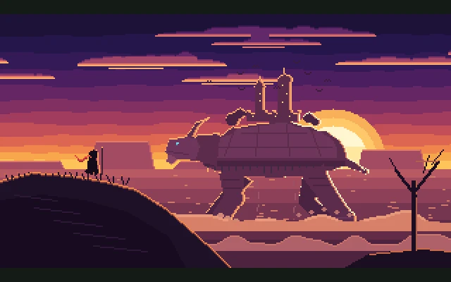<br><strong>걷는 거상</strong></a><br><sub>도시를 짊어진 돌짐승이 노을 앞을 걸어갑니다.</sub><br><a href="works/walking-colossus/source.js">소스</a> · <a href="docs/works.ko.md#walking-colossus">조작 안내</a></td>
<td width="33%" valign="top"><a href="https://ma1902056219-coder.github.io/openpixel/works/uv-graffiti/">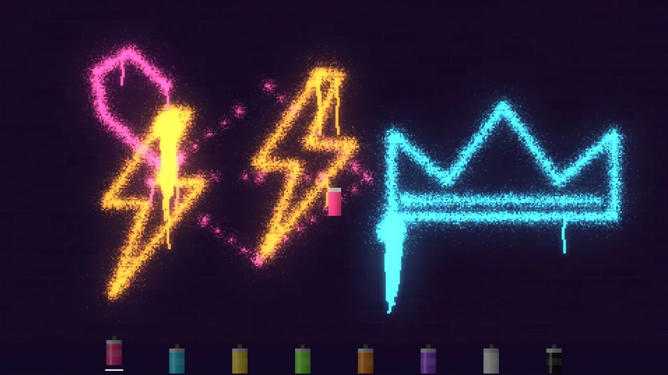<br><strong>형광 스프레이</strong></a><br><sub>벽돌 벽에 칠하고 자외선을 켜면 페인트가 빛납니다.</sub><br><a href="works/uv-graffiti/source.js">소스</a> · <a href="docs/works.ko.md#uv-graffiti">조작 안내</a></td>
</tr>
<tr>
<td width="33%" valign="top"><a href="https://ma1902056219-coder.github.io/openpixel/works/bell-at-dawn/">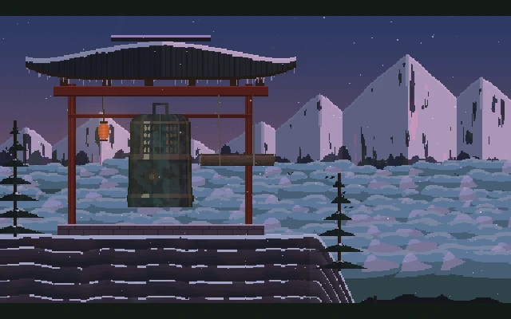<br><strong>새벽 종소리</strong></a><br><sub>종을 치면 구름이 밀려나고 눈이 떨어집니다.</sub><br><a href="works/bell-at-dawn/source.js">소스</a> · <a href="docs/works.ko.md#bell-at-dawn">조작 안내</a></td>
<td width="33%" valign="top"><a href="https://ma1902056219-coder.github.io/openpixel/works/flipdot-night/">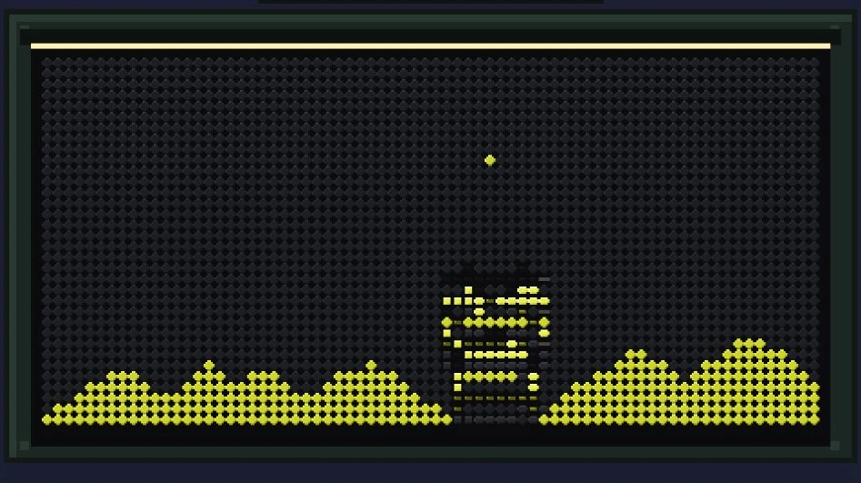<br><strong>플립닷 전광판의 하룻밤</strong></a><br><sub>역의 전광판에서 떨어진 글자가 모래언덕이 됩니다.</sub><br><a href="works/flipdot-night/source.js">소스</a> · <a href="docs/works.ko.md#flipdot-night">조작 안내</a></td>
<td width="33%"></td>
</tr>
</table>

## 네 번째 공개 · 픽셀 실험 5개

빛점 1200개로 고래를 만들고, 번개를 그리거나 비눗방울을 불어 보세요. 이슬의 굴절과 논 그림의 원근법도 직접 실행하고 고칠 수 있습니다.

<table>
<tr>
<td width="33%" valign="top"><a href="https://ma1902056219-coder.github.io/openpixel/works/drone-light-show/">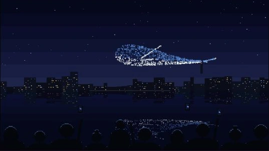<br><strong>천 개의 빛이 있는 밤</strong></a><br><sub>같은 빛점 1200개가 지구와 고래, 달로 변합니다.</sub><br><a href="works/drone-light-show/source.js">소스</a> · <a href="docs/works.ko.md#drone-light-show">조작 안내</a></td>
<td width="33%" valign="top"><a href="https://ma1902056219-coder.github.io/openpixel/works/storm-lightning/">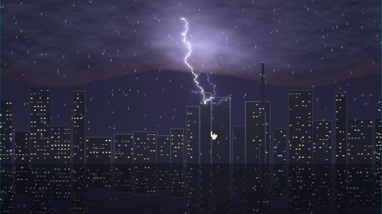<br><strong>뇌우</strong></a><br><sub>구름에서 선을 그리면 가지가 갈라지는 번개가 칩니다.</sub><br><a href="works/storm-lightning/source.js">소스</a> · <a href="docs/works.ko.md#storm-lightning">조작 안내</a></td>
<td width="33%" valign="top"><a href="https://ma1902056219-coder.github.io/openpixel/works/soap-film/">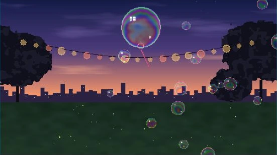<br><strong>비눗방울 막</strong></a><br><sub>막이 얇아지며 색이 변하는 비눗방울을 만들고 터뜨립니다.</sub><br><a href="works/soap-film/source.js">소스</a> · <a href="docs/works.ko.md#soap-film">조작 안내</a></td>
</tr>
<tr>
<td width="33%" valign="top"><a href="https://ma1902056219-coder.github.io/openpixel/works/dewdrop-refraction/">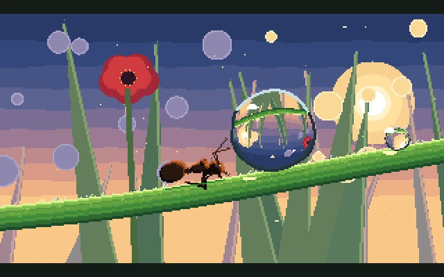<br><strong>이슬 한 방울</strong></a><br><sub>이슬 속에 거꾸로 비친 꽃을 볼 수 있습니다.</sub><br><a href="works/dewdrop-refraction/source.js">소스</a> · <a href="docs/works.ko.md#dewdrop-refraction">조작 안내</a></td>
<td width="33%" valign="top"><a href="https://ma1902056219-coder.github.io/openpixel/works/rice-field-perspective/">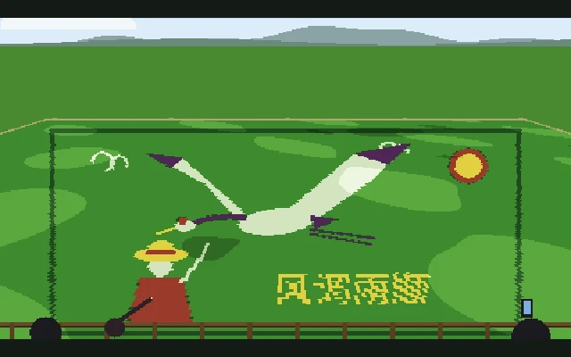<br><strong>논 그림</strong></a><br><sub>전망대에 오르면 논의 색 조각이 두루미로 보입니다.</sub><br><a href="works/rice-field-perspective/source.js">소스</a> · <a href="docs/works.ko.md#rice-field-perspective">조작 안내</a></td>
<td width="33%"></td>
</tr>
</table>

## 세 번째 공개 · 픽셀 실험 5개

색만 바꿔 폭포를 흐르게 하고 니트 무늬를 움직여 보세요. 나뭇그늘 속 일식, 빗방울 악기, 수묵 효과도 각각 실행하고 코드를 바꿀 수 있습니다.

<table>
<tr>
<td width="33%" valign="top"><a href="https://ma1902056219-coder.github.io/openpixel/works/palette-waterfall/">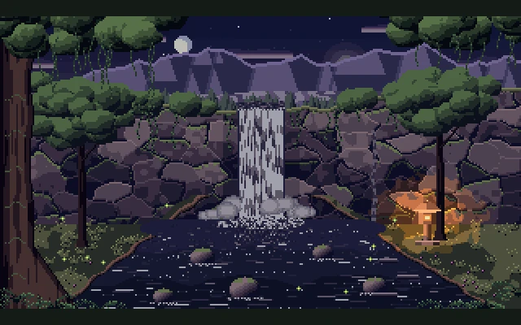<br><strong>색 순환 폭포</strong></a><br><sub>팔레트 색을 순환시켜 폭포를 흐르게 합니다.</sub><br><a href="works/palette-waterfall/source.js">소스</a> · <a href="docs/works.ko.md#palette-waterfall">조작 안내</a></td>
<td width="33%" valign="top"><a href="https://ma1902056219-coder.github.io/openpixel/works/living-knit/">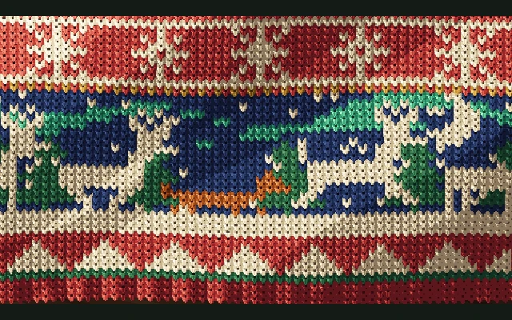<br><strong>살아 움직이는 니트</strong></a><br><sub>한 코씩 뜬 무늬가 움직이고 고양이가 실을 당깁니다.</sub><br><a href="works/living-knit/source.js">소스</a> · <a href="docs/works.ko.md#living-knit">조작 안내</a></td>
<td width="33%" valign="top"><a href="https://ma1902056219-coder.github.io/openpixel/works/pinhole-eclipse/">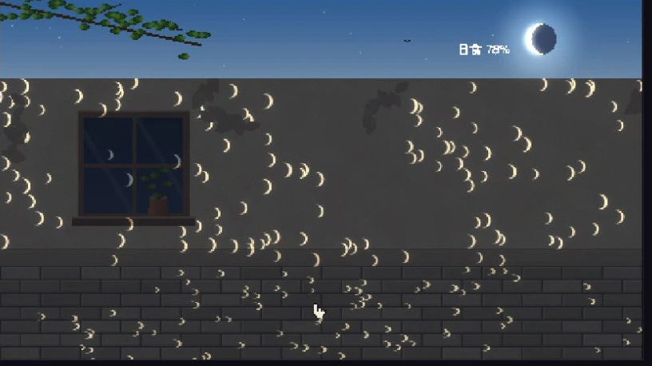<br><strong>나뭇그늘 속 일식</strong></a><br><sub>달을 움직이면 둥근 빛이 모두 초승달 모양으로 바뀝니다.</sub><br><a href="works/pinhole-eclipse/source.js">소스</a> · <a href="docs/works.ko.md#pinhole-eclipse">조작 안내</a></td>
</tr>
<tr>
<td width="33%" valign="top"><a href="https://ma1902056219-coder.github.io/openpixel/works/rain-instrument/">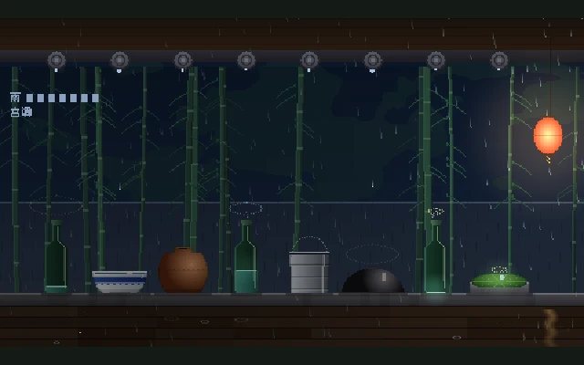<br><strong>빗방울 악기</strong></a><br><sub>처마 아래 그릇을 움직여 빗방울의 리듬을 바꿉니다.</sub><br><a href="works/rain-instrument/source.js">소스</a> · <a href="docs/works.ko.md#rain-instrument">조작 안내</a></td>
<td width="33%" valign="top"><a href="https://ma1902056219-coder.github.io/openpixel/works/ink-slash/">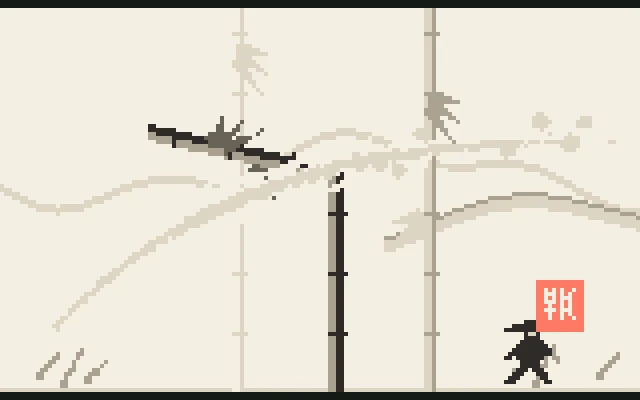<br><strong>수묵 한 획</strong></a><br><sub>마른 붓의 먹 자국이 그어진 뒤 대나무가 쓰러집니다.</sub><br><a href="works/ink-slash/source.js">소스</a> · <a href="docs/works.ko.md#ink-slash">조작 안내</a></td>
<td width="33%"></td>
</tr>
</table>

## 두 번째 공개 · 직접 바꿔 볼 다섯 실험

쇳물 불꽃부터 민들레 씨앗까지. 각 폴더를 독립 실행할 수 있으며 편집 가능한 코드와 조작 설명이 있습니다.

<table>
<tr>
<td width="33%" valign="top"><a href="https://ma1902056219-coder.github.io/openpixel/works/iron-flower/">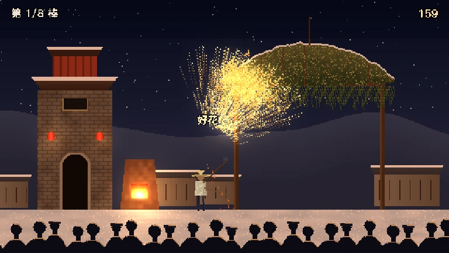<br><strong>쇳물 꽃불</strong></a><br><sub>쇳물을 쳐 올려 마을을 비추는 금빛 불꽃을 만듭니다.</sub><br><a href="works/iron-flower/source.js">소스 보기</a> · <a href="docs/works.ko.md#iron-flower">조작 안내</a></td>
<td width="33%" valign="top"><a href="https://ma1902056219-coder.github.io/openpixel/works/watercolor/">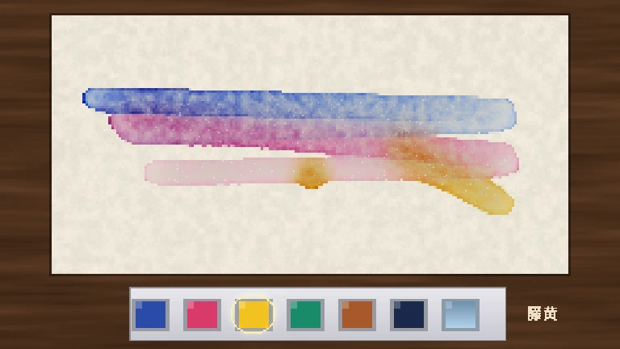<br><strong>수채화 번짐</strong></a><br><sub>젖은 종이에서 물감이 퍼지고 섞이는 모습을 그립니다.</sub><br><a href="works/watercolor/source.js">소스 보기</a> · <a href="docs/works.ko.md#watercolor">조작 안내</a></td>
<td width="33%" valign="top"><a href="https://ma1902056219-coder.github.io/openpixel/works/coral-reef/">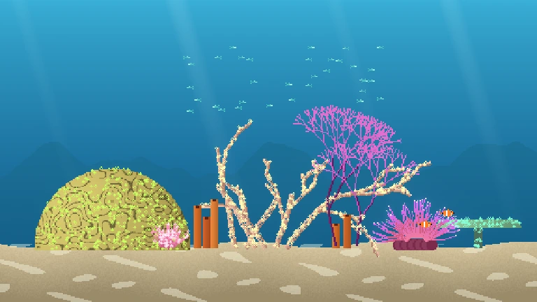<br><strong>산호초</strong></a><br><sub>산호를 건드리거나 물살을 만들면 작은 바닷속 세계가 반응합니다.</sub><br><a href="works/coral-reef/source.js">소스 보기</a> · <a href="docs/works.ko.md#coral-reef">조작 안내</a></td>
</tr>
<tr>
<td width="33%" valign="top"><a href="https://ma1902056219-coder.github.io/openpixel/works/dandelion/">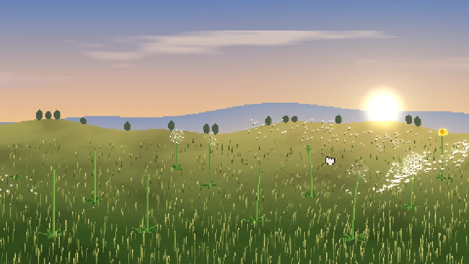<br><strong>민들레</strong></a><br><sub>씨앗을 날리고 땅에 떨어진 씨앗이 새로 자라는 모습을 봅니다.</sub><br><a href="works/dandelion/source.js">소스 보기</a> · <a href="docs/works.ko.md#dandelion">조작 안내</a></td>
<td width="33%" valign="top"><a href="https://ma1902056219-coder.github.io/openpixel/works/kaleidoscope/">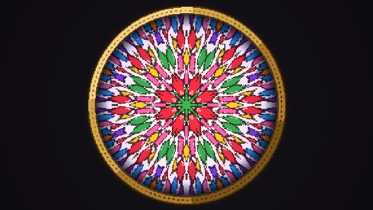<br><strong>만화경</strong></a><br><sub>통을 돌릴 때마다 색 조각이 새로운 대칭 무늬를 만듭니다.</sub><br><a href="works/kaleidoscope/source.js">소스 보기</a> · <a href="docs/works.ko.md#kaleidoscope">조작 안내</a></td>
<td width="33%"></td>
</tr>
</table>

<a id="start"></a>

## 로컬에서 실행하기

1. [작품 모음을 다운로드하고 압축을 풀거나](https://github.com/ma1902056219-coder/openpixel/archive/refs/heads/main.zip) 저장소를 clone 합니다.
2. 루트의 `index.html` 또는 `works/<작품명>/index.html`을 엽니다.
3. 데모를 본 뒤 각 페이지의 조작 안내에 따라 직접 움직여 보세요.

브라우저가 로컬 파일을 제한한다면 로컬 서버를 실행하세요.

```bash
git clone https://github.com/ma1902056219-coder/openpixel.git
cd openpixel
python -m http.server 8080 --bind 127.0.0.1
```

[로컬 작품 모음](http://127.0.0.1:8080)을 여세요. 종료하려면 터미널에서 `Ctrl+C`를 누릅니다.

README, 수정 가이드, 작품 조작 안내는 네 가지 언어로 제공됩니다. 작품 내 UI와 소스 주석은 주로 중국어입니다. 키보드와 마우스를 사용하는 데스크톱 브라우저를 권장하며, 터치 지원은 작품마다 다릅니다.

<a id="gallery"></a>

## 작품 목록

카드를 클릭하면 브라우저에서 바로 체험할 수 있습니다. 조작 안내와 소스도 제공하며, 다운로드해 오프라인으로 실행할 수도 있습니다.

### 상호작용과 질감

<table>
<tr>
<td width="33%" valign="top"><a href="https://ma1902056219-coder.github.io/openpixel/works/night-pond/"><br><strong>밤의 연못</strong></a><br><sub>물결로 반사상을 흔들고 비단잉어에게 먹이를 주세요.</sub><br><a href="works/night-pond/source.js">소스 보기</a> · <a href="docs/works.ko.md#night-pond">조작 안내</a></td>
<td width="33%" valign="top"><a href="https://ma1902056219-coder.github.io/openpixel/works/plasma-globe/"><br><strong>플라즈마 볼</strong></a><br><sub>전기 아크를 손끝으로 모아 움직여 보세요.</sub><br><a href="works/plasma-globe/source.js">소스 보기</a> · <a href="docs/works.ko.md#plasma-globe">조작 안내</a></td>
<td width="33%" valign="top"><a href="https://ma1902056219-coder.github.io/openpixel/works/chladni-plate/"><br><strong>클라드니 판</strong></a><br><sub>진동에 따라 모래가 다양한 무늬로 모입니다.</sub><br><a href="works/chladni-plate/source.js">소스 보기</a> · <a href="docs/works.ko.md#chladni-plate">조작 안내</a></td>
</tr>
<tr>
<td width="33%" valign="top"><a href="https://ma1902056219-coder.github.io/openpixel/works/ferrofluid/"><br><strong>자성유체</strong></a><br><sub>자기장을 움직여 액체의 뾰족한 형태와 반사를 바꿉니다.</sub><br><a href="works/ferrofluid/source.js">소스 보기</a> · <a href="docs/works.ko.md#ferrofluid">조작 안내</a></td>
<td width="33%" valign="top"><a href="https://ma1902056219-coder.github.io/openpixel/works/cracking-ice/"><br><strong>갈라지는 얼음</strong></a><br><sub>힘을 가하면 얼어붙은 표면에 균열이 퍼집니다.</sub><br><a href="works/cracking-ice/source.js">소스 보기</a> · <a href="docs/works.ko.md#cracking-ice">조작 안내</a></td>
<td width="33%" valign="top"><a href="https://ma1902056219-coder.github.io/openpixel/works/frost-window/"><br><strong>성에 낀 창</strong></a><br><sub>성에를 닦아 내고 다시 자라는 모습을 관찰하세요.</sub><br><a href="works/frost-window/source.js">소스 보기</a> · <a href="docs/works.ko.md#frost-window">조작 안내</a></td>
</tr>
<tr>
<td width="33%" valign="top"><a href="https://ma1902056219-coder.github.io/openpixel/works/zen-garden/"><br><strong>젠 가든</strong></a><br><sub>모래에 무늬를 남기고 시간대와 날씨를 바꿉니다.</sub><br><a href="works/zen-garden/source.js">소스 보기</a> · <a href="docs/works.ko.md#zen-garden">조작 안내</a></td>
<td width="33%" valign="top"><a href="https://ma1902056219-coder.github.io/openpixel/works/pottery/"><br><strong>물레 빚기</strong></a><br><sub>돌아가는 물레 위에서 흙의 형태를 만듭니다.</sub><br><a href="works/pottery/source.js">소스 보기</a> · <a href="docs/works.ko.md#pottery">조작 안내</a></td>
<td width="33%" valign="top"><a href="https://ma1902056219-coder.github.io/openpixel/works/kintsugi/"><br><strong>긴츠기</strong></a><br><sub>깨진 도자기를 맞추고 옻칠, 금가루, 연마를 진행합니다.</sub><br><a href="works/kintsugi/source.js">소스 보기</a> · <a href="docs/works.ko.md#kintsugi">조작 안내</a></td>
</tr>
<tr>
<td width="33%" valign="top"><a href="https://ma1902056219-coder.github.io/openpixel/works/light-painting/"><br><strong>라이트 페인팅</strong></a><br><sub>빛의 궤적을 겹쳐 소용돌이와 빛의 층을 만듭니다.</sub><br><a href="works/light-painting/source.js">소스 보기</a> · <a href="docs/works.ko.md#light-painting">조작 안내</a></td>
<td width="33%"></td>
<td width="33%"></td>
</tr>
</table>

### 자연과 우주

<table>
<tr>
<td width="33%" valign="top"><a href="https://ma1902056219-coder.github.io/openpixel/works/sardine-storm/"><br><strong>정어리 폭풍</strong></a><br><sub>소용돌이치는 물고기 떼 사이로 돌고래를 움직여 보세요.</sub><br><a href="works/sardine-storm/source.js">소스 보기</a> · <a href="docs/works.ko.md#sardine-storm">조작 안내</a></td>
<td width="33%" valign="top"><a href="https://ma1902056219-coder.github.io/openpixel/works/jellyfish/"><br><strong>해파리</strong></a><br><sub>반투명한 몸과 부드러운 촉수, 연달아 퍼지는 빛.</sub><br><a href="works/jellyfish/source.js">소스 보기</a> · <a href="docs/works.ko.md#jellyfish">조작 안내</a></td>
<td width="33%" valign="top"><a href="https://ma1902056219-coder.github.io/openpixel/works/saturn-rings/"><br><strong>토성의 고리</strong></a><br><sub>위성을 던져 넣고 부서져 고리가 되는 모습을 관찰하세요.</sub><br><a href="works/saturn-rings/source.js">소스 보기</a> · <a href="docs/works.ko.md#saturn-rings">조작 안내</a></td>
</tr>
<tr>
<td width="33%" valign="top"><a href="https://ma1902056219-coder.github.io/openpixel/works/galaxy-collision/"><br><strong>은하 충돌</strong></a><br><sub>두 은하가 만나며 별의 궤적이 긴 꼬리를 만듭니다.</sub><br><a href="works/galaxy-collision/source.js">소스 보기</a> · <a href="docs/works.ko.md#galaxy-collision">조작 안내</a></td>
<td width="33%" valign="top"><a href="https://ma1902056219-coder.github.io/openpixel/works/black-hole/"><br><strong>블랙홀</strong></a><br><sub>강착 원반과 렌즈 효과, 움직이는 별빛.</sub><br><a href="works/black-hole/source.js">소스 보기</a> · <a href="docs/works.ko.md#black-hole">조작 안내</a></td>
<td width="33%" valign="top"><a href="https://ma1902056219-coder.github.io/openpixel/works/solar-limb/"><br><strong>태양의 가장자리</strong></a><br><sub>홍염, 태양의 쌀알무늬, 크기 비교용 지구.</sub><br><a href="works/solar-limb/source.js">소스 보기</a> · <a href="docs/works.ko.md#solar-limb">조작 안내</a></td>
</tr>
<tr>
<td width="33%" valign="top"><a href="https://ma1902056219-coder.github.io/openpixel/works/aurora/"><br><strong>오로라</strong></a><br><sub>설산과 오두막, 수면 위로 흔들리는 빛의 커튼.</sub><br><a href="works/aurora/source.js">소스 보기</a> · <a href="docs/works.ko.md#aurora">조작 안내</a></td>
<td width="33%"></td>
<td width="33%"></td>
</tr>
</table>

### 공간과 착시

<table>
<tr>
<td width="33%" valign="top"><a href="https://ma1902056219-coder.github.io/openpixel/works/endless-window/"><br><strong>끝없는 창</strong></a><br><sub>여섯 겹의 세계가 이어져 처음 풍경으로 돌아옵니다.</sub><br><a href="works/endless-window/source.js">소스 보기</a> · <a href="docs/works.ko.md#endless-window">조작 안내</a></td>
<td width="33%" valign="top"><a href="https://ma1902056219-coder.github.io/openpixel/works/penrose-tower/"><br><strong>끝없이 오르는 탑</strong></a><br><sub>시점을 돌려 불가능한 계단의 구조를 확인하세요.</sub><br><a href="works/penrose-tower/source.js">소스 보기</a> · <a href="docs/works.ko.md#penrose-tower">조작 안내</a></td>
<td width="33%" valign="top"><a href="https://ma1902056219-coder.github.io/openpixel/works/living-jigsaw/"><br><strong>살아 움직이는 퍼즐</strong></a><br><sub>맞춰진 조각이 움직이고 마지막 조각이 놓이면 버스가 출발합니다.</sub><br><a href="works/living-jigsaw/source.js">소스 보기</a> · <a href="docs/works.ko.md#living-jigsaw">조작 안내</a></td>
</tr>
<tr>
<td width="33%" valign="top"><a href="https://ma1902056219-coder.github.io/openpixel/works/ocean-in-a-tank/"><br><strong>어항 속 바다</strong></a><br><sub>책상 위 작은 어항 속에 훨씬 넓은 바다가 숨어 있습니다.</sub><br><a href="works/ocean-in-a-tank/source.js">소스 보기</a> · <a href="docs/works.ko.md#ocean-in-a-tank">조작 안내</a></td>
<td width="33%"></td>
<td width="33%"></td>
</tr>
</table>

### 플레이 가능한 장면

<table>
<tr>
<td width="33%" valign="top"><a href="https://ma1902056219-coder.github.io/openpixel/works/crown-knight/"><br><strong>왕관을 잃은 기사</strong></a><br><sub>회피, 경직, 카메라 전환이 있는 보스 전투.</sub><br><a href="works/crown-knight/source.js">소스 보기</a> · <a href="docs/works.ko.md#crown-knight">조작 안내</a></td>
<td width="33%" valign="top"><a href="https://ma1902056219-coder.github.io/openpixel/works/sunset-loop/"><br><strong>노을 순환도로</strong></a><br><sub>차량 뒤에서 바라보며 노을을 향해 달립니다.</sub><br><a href="works/sunset-loop/source.js">소스 보기</a> · <a href="docs/works.ko.md#sunset-loop">조작 안내</a></td>
<td width="33%"></td>
</tr>
</table>

### 픽셀 풍경

<table>
<tr>
<td width="33%" valign="top"><a href="https://ma1902056219-coder.github.io/openpixel/works/thousand-li/"><br><strong>천리강산</strong></a><br><sub>청록 산수화가 움직이는 두루마리로 펼쳐집니다.</sub><br><a href="works/thousand-li/source.js">소스 보기</a> · <a href="docs/works.ko.md#thousand-li">조작 안내</a></td>
<td width="33%" valign="top"><a href="https://ma1902056219-coder.github.io/openpixel/works/rainbow-bridge/"><br><strong>청명상하도 · 무지개다리</strong></a><br><sub>배, 노점, 행인이 오가는 작은 두루마리 풍경.</sub><br><a href="works/rainbow-bridge/source.js">소스 보기</a> · <a href="docs/works.ko.md#rainbow-bridge">조작 안내</a></td>
<td width="33%" valign="top"><a href="https://ma1902056219-coder.github.io/openpixel/works/rose-window/"><br><strong>고딕 장미창</strong></a><br><sub>스테인드글라스의 빛이 성당 바닥을 천천히 움직입니다.</sub><br><a href="works/rose-window/source.js">소스 보기</a> · <a href="docs/works.ko.md#rose-window">조작 안내</a></td>
</tr>
</table>

## 나만의 버전으로 바꾸기

작품 폴더 전체를 복사하고 `source.js`를 수정한 뒤 실행 페이지를 새로고침하세요. 먼저 색상이나 수치 하나만 바꾸고 데모와 수동 조작을 모두 확인하는 것이 좋습니다.

원본 프로젝트는 Claude의 도움을 받아 프로그래밍했습니다. 폴더 전체와 구체적인 요청을 GPT, Gemini 등 코딩 도우미에게 전달해 수정할 수도 있습니다. 변경 후에는 반드시 직접 실행해 확인하세요. 예시는 [수정 가이드](docs/guide.ko.md)에 있습니다.

```text
source.js를 읽고 초기화, 프레임별 갱신, 그리기 함수를 찾아주세요.
기존 조작을 유지하면서 밤 풍경의 색상을 노을 색상으로 바꿔주세요.
변경 위치를 먼저 설명하고 외부 이미지, 서비스, 의존성은 추가하지 마세요.
```

## 파일 구성

각 `works/<slug>/` 폴더에는 `index.html`, `source.js`, 읽기 전용 `source.html`, `poster.webp`, 중국어 `README.md`, `LICENSE`가 있습니다. [한국어 작품 조작 안내](docs/works.ko.md)에서 각 작품의 사용법을 확인할 수 있습니다. 폴더 하나만 복사해 사용할 수 있도록 공통 실행 코드도 각 작품에 포함했습니다.

픽셀 아트와 작은 플레이 실험을 모은 프로젝트입니다. 전투와 운전은 단순화된 프로토타입 규칙을 사용합니다. 시스템 글꼴과 무작위 요소 때문에 실행할 때마다 일부 화면이 달라질 수 있습니다.

## 업데이트와 참여

다섯 차례 공개로 현재 총 46개 작품을 제공합니다. 새로운 효과도 비정기적으로 공개할 예정입니다. 조작성, 시각 효과, 성능 개선을 환영합니다. 문제를 제보할 때는 작품명, 브라우저, 재현 단계를 적어주세요. Pull Request에는 변경 내용과 데모·수동 조작 확인 결과를 함께 적어주세요. 원문 참여 안내는 [CONTRIBUTING.md](CONTRIBUTING.md)에 있습니다.

## 제작자와 라이선스

**喵老弟 [@MarkMFFF](https://x.com/MarkMFFF)**가 정리하고 관리합니다. X에서 작품 데모, 제작 과정, 다음 공개 소식을 볼 수 있습니다.

코드는 [MIT License](LICENSE)로 공개합니다. 재사용 시 저작권 표시와 라이선스 문구를 유지해주세요. 스타일 참고는 상업용 게임이나 브랜드와의 제휴를 뜻하지 않습니다. 원본 파일 해시와 정리 기록은 [SOURCE_NOTES.md](SOURCE_NOTES.md)에 있습니다.
