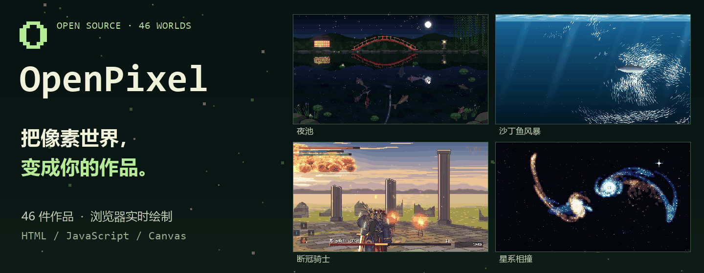
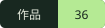
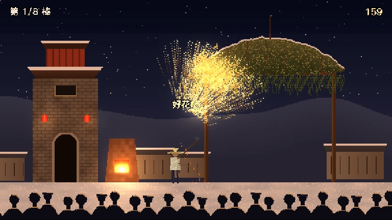
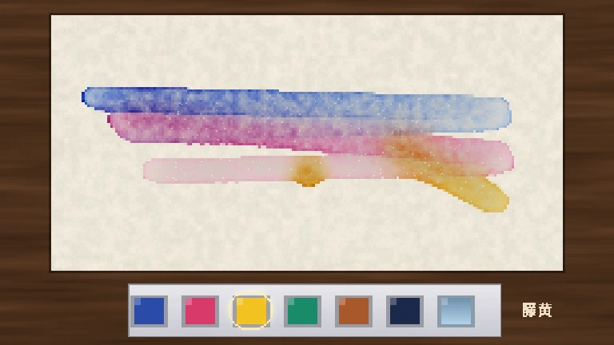
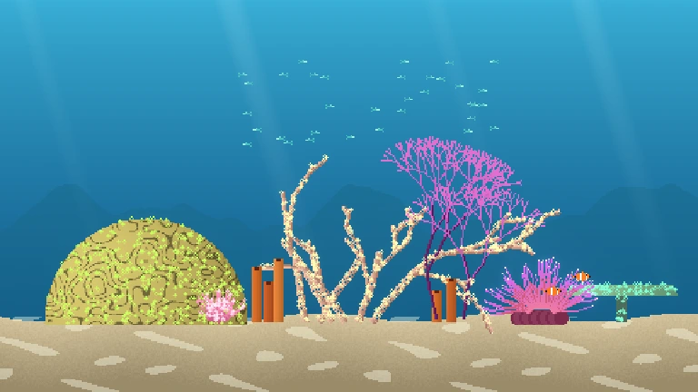
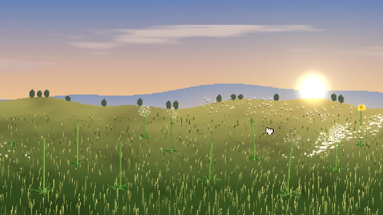
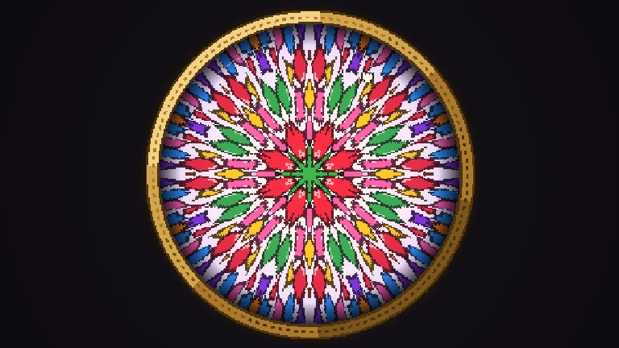

<div align="center">

[中文](README.md) · [English](README.en.md) · [日本語](README.ja.md) · [한국어](README.ko.md)

<a href="https://ma1902056219-coder.github.io/openpixel/"></a>

# OpenPixel · 像素万象

**把像素世界，变成你的作品。**

31 个浏览器实时绘制的像素实验：从一滴水的涟漪，到两座星系的相撞。

  <a href="LICENSE"></a>

[下载当前源码](https://github.com/ma1902056219-coder/openpixel/archive/refs/heads/main.zip) · [作品目录](#作品目录) · [开始运行](#开始运行) · [修改指南](docs/guide.md)


**[▶ 在线体验全部作品](https://ma1902056219-coder.github.io/openpixel/)**

</div>

## 先看它们动起来

<div align="center">

</div>

来自真实运行的作品画面。点击作品图卡即可在线体验，也能下载源码改成自己的版本。

- **伸手触碰**：点水喂鱼、移动磁场、擦去霜花、在砂面留下耙痕。
- **观察变化**：卫星碎裂成环、鱼群躲避海豚、恒星轨迹拉出长尾。
- **走进场景**：首领战、落日驾驶、拼好后开始运动的微型世界。
- **直接改源码**：每件作品独立成目录，附实际画面和中文说明，无需构建或 AI 接口。

仓库首页、修改指南和31件作品的操作说明现提供中文、英文、日文、韩文。作品内界面及源码注释仍以中文为主。

## 第二批新增 · 5 个可拆解的像素实验

从一棒铁花到一颗种子：每个目录都能独立运行，附源码、操作方法与修改方向。

<table>
<tr>
<td width="33%" valign="top"><a href="https://ma1902056219-coder.github.io/openpixel/works/iron-flower/"><br><strong>打铁花</strong></a><br><sub>雪夜里，一棒打出满天铁花</sub><br><a href="works/iron-flower/source.js">查看源码</a> · <a href="works/iron-flower/README.md">操作说明</a></td>
<td width="33%" valign="top"><a href="https://ma1902056219-coder.github.io/openpixel/works/watercolor/"><br><strong>水彩晕染</strong></a><br><sub>让颜色在湿纸上自己生长</sub><br><a href="works/watercolor/source.js">查看源码</a> · <a href="works/watercolor/README.md">操作说明</a></td>
<td width="33%" valign="top"><a href="https://ma1902056219-coder.github.io/openpixel/works/coral-reef/"><br><strong>珊瑚礁</strong></a><br><sub>碰一下，整片珊瑚依次收起</sub><br><a href="works/coral-reef/source.js">查看源码</a> · <a href="works/coral-reef/README.md">操作说明</a></td>
</tr>
<tr>
<td width="33%" valign="top"><a href="https://ma1902056219-coder.github.io/openpixel/works/dandelion/"><br><strong>蒲公英</strong></a><br><sub>吹散一朵，再长出一片</sub><br><a href="works/dandelion/source.js">查看源码</a> · <a href="works/dandelion/README.md">操作说明</a></td>
<td width="33%" valign="top"><a href="https://ma1902056219-coder.github.io/openpixel/works/kaleidoscope/"><br><strong>万花筒</strong></a><br><sub>转一下，就得到一朵新图案</sub><br><a href="works/kaleidoscope/source.js">查看源码</a> · <a href="works/kaleidoscope/README.md">操作说明</a></td>
<td width="33%"></td>
</tr>
</table>

## 开始运行

1. [下载并解压合集](https://github.com/ma1902056219-coder/openpixel/archive/refs/heads/main.zip)，或克隆此仓库。
2. 双击根目录 `index.html` 进入合集，也可以直接打开任一 `works/<作品目录>/index.html`。
3. 先看演示，再点击画面接管操作；每件作品的按键和玩法写在对应页面里。

如果浏览器限制本地文件，或希望用本地服务器运行：

```bash
git clone https://github.com/ma1902056219-coder/openpixel.git
cd openpixel
python -m http.server 8080 --bind 127.0.0.1
```

打开 [本地合集](http://127.0.0.1:8080)。结束时在终端按 `Ctrl+C`。

推荐桌面浏览器与键鼠操作。声音需要浏览器允许，必要时先点击声音按钮；触摸能力以各作品控件为准。

## 作品目录

**点击图卡直接在线体验；每件作品另附操作说明与源码，也可下载后离线运行。** 当前合集共 31 件，每件都附可编辑的 `source.js`。

### 互动与材质

<table>
<tr>
<td width="33%" valign="top"><a href="https://ma1902056219-coder.github.io/openpixel/works/night-pond/"><br><strong>夜池</strong></a><br><sub>点水扭曲倒影，投食让锦鲤靠近</sub><br><a href="works/night-pond/source.js">查看源码</a> · <a href="works/night-pond/README.md">操作说明</a></td>
<td width="33%" valign="top"><a href="https://ma1902056219-coder.github.io/openpixel/works/plasma-globe/"><br><strong>等离子球</strong></a><br><sub>手指聚拢电弧，切换电光颜色</sub><br><a href="works/plasma-globe/source.js">查看源码</a> · <a href="works/plasma-globe/README.md">操作说明</a></td>
<td width="33%" valign="top"><a href="https://ma1902056219-coder.github.io/openpixel/works/chladni-plate/"><br><strong>克拉尼板</strong></a><br><sub>振动频率改变粒子形成的结线图案</sub><br><a href="works/chladni-plate/source.js">查看源码</a> · <a href="works/chladni-plate/README.md">操作说明</a></td>
</tr>
<tr>
<td width="33%" valign="top"><a href="https://ma1902056219-coder.github.io/openpixel/works/ferrofluid/"><br><strong>磁流体</strong></a><br><sub>移动磁场，控制黑色液体的尖峰与反光</sub><br><a href="works/ferrofluid/source.js">查看源码</a> · <a href="works/ferrofluid/README.md">操作说明</a></td>
<td width="33%" valign="top"><a href="https://ma1902056219-coder.github.io/openpixel/works/cracking-ice/"><br><strong>冰裂</strong></a><br><sub>按压裂冰，观察应力线与碎裂传播</sub><br><a href="works/cracking-ice/source.js">查看源码</a> · <a href="works/cracking-ice/README.md">操作说明</a></td>
<td width="33%" valign="top"><a href="https://ma1902056219-coder.github.io/openpixel/works/frost-window/"><br><strong>霜窗</strong></a><br><sub>擦除霜花，观察玻璃水珠与霜的再生</sub><br><a href="works/frost-window/source.js">查看源码</a> · <a href="works/frost-window/README.md">操作说明</a></td>
</tr>
<tr>
<td width="33%" valign="top"><a href="https://ma1902056219-coder.github.io/openpixel/works/zen-garden/"><br><strong>枯山水</strong></a><br><sub>拖动耙砂，保留高度场与光影的变化</sub><br><a href="works/zen-garden/source.js">查看源码</a> · <a href="works/zen-garden/README.md">操作说明</a></td>
<td width="33%" valign="top"><a href="https://ma1902056219-coder.github.io/openpixel/works/pottery/"><br><strong>拉坯</strong></a><br><sub>拉坯塑形，观察轮廓、旋转与材质</sub><br><a href="works/pottery/source.js">查看源码</a> · <a href="works/pottery/README.md">操作说明</a></td>
<td width="33%" valign="top"><a href="https://ma1902056219-coder.github.io/openpixel/works/kintsugi/"><br><strong>金缮</strong></a><br><sub>碎片拼合、修补与金色接缝</sub><br><a href="works/kintsugi/source.js">查看源码</a> · <a href="works/kintsugi/README.md">操作说明</a></td>
</tr>
<tr>
<td width="33%" valign="top"><a href="https://ma1902056219-coder.github.io/openpixel/works/light-painting/"><br><strong>光绘</strong></a><br><sub>光轨累积、空间旋涡与加色光晕</sub><br><a href="works/light-painting/source.js">查看源码</a> · <a href="works/light-painting/README.md">操作说明</a></td>
<td width="33%"></td>
<td width="33%"></td>
</tr>
</table>

### 自然与宇宙

<table>
<tr>
<td width="33%" valign="top"><a href="https://ma1902056219-coder.github.io/openpixel/works/sardine-storm/"><br><strong>沙丁鱼风暴</strong></a><br><sub>鱼群受海豚扰动聚合，观察整体运动</sub><br><a href="works/sardine-storm/source.js">查看源码</a> · <a href="works/sardine-storm/README.md">操作说明</a></td>
<td width="33%" valign="top"><a href="https://ma1902056219-coder.github.io/openpixel/works/jellyfish/"><br><strong>水母</strong></a><br><sub>半透明水母、柔软触须与触碰后的发光</sub><br><a href="works/jellyfish/source.js">查看源码</a> · <a href="works/jellyfish/README.md">操作说明</a></td>
<td width="33%" valign="top"><a href="https://ma1902056219-coder.github.io/openpixel/works/saturn-rings/"><br><strong>土星环</strong></a><br><sub>投放卫星，观察近轨道碎裂与成环</sub><br><a href="works/saturn-rings/source.js">查看源码</a> · <a href="works/saturn-rings/README.md">操作说明</a></td>
</tr>
<tr>
<td width="33%" valign="top"><a href="https://ma1902056219-coder.github.io/openpixel/works/galaxy-collision/"><br><strong>星系相撞</strong></a><br><sub>双星系接近，恒星轨迹拉成长尾</sub><br><a href="works/galaxy-collision/source.js">查看源码</a> · <a href="works/galaxy-collision/README.md">操作说明</a></td>
<td width="33%" valign="top"><a href="https://ma1902056219-coder.github.io/openpixel/works/black-hole/"><br><strong>黑洞</strong></a><br><sub>吸积盘与透镜视觉，参数化生成宇宙场景</sub><br><a href="works/black-hole/source.js">查看源码</a> · <a href="works/black-hole/README.md">操作说明</a></td>
<td width="33%" valign="top"><a href="https://ma1902056219-coder.github.io/openpixel/works/solar-limb/"><br><strong>太阳边缘</strong></a><br><sub>日珥、太阳颗粒和地球比例尺</sub><br><a href="works/solar-limb/source.js">查看源码</a> · <a href="works/solar-limb/README.md">操作说明</a></td>
</tr>
<tr>
<td width="33%" valign="top"><a href="https://ma1902056219-coder.github.io/openpixel/works/aurora/"><br><strong>极光</strong></a><br><sub>极光带、雪山、木屋与水面倒影</sub><br><a href="works/aurora/source.js">查看源码</a> · <a href="works/aurora/README.md">操作说明</a></td>
<td width="33%"></td>
<td width="33%"></td>
</tr>
</table>

### 空间与错觉

<table>
<tr>
<td width="33%" valign="top"><a href="https://ma1902056219-coder.github.io/openpixel/works/endless-window/"><br><strong>无尽之窗</strong></a><br><sub>六层嵌套首尾相连，连续推进回到起点</sub><br><a href="works/endless-window/source.js">查看源码</a> · <a href="works/endless-window/README.md">操作说明</a></td>
<td width="33%" valign="top"><a href="https://ma1902056219-coder.github.io/openpixel/works/penrose-tower/"><br><strong>永登之塔</strong></a><br><sub>转动视角，揭示看似无限上升的楼梯</sub><br><a href="works/penrose-tower/source.js">查看源码</a> · <a href="works/penrose-tower/README.md">操作说明</a></td>
<td width="33%" valign="top"><a href="https://ma1902056219-coder.github.io/openpixel/works/living-jigsaw/"><br><strong>活拼图</strong></a><br><sub>从多块拼装到画面活过来，路通后车辆前进</sub><br><a href="works/living-jigsaw/source.js">查看源码</a> · <a href="works/living-jigsaw/README.md">操作说明</a></td>
</tr>
<tr>
<td width="33%" valign="top"><a href="https://ma1902056219-coder.github.io/openpixel/works/ocean-in-a-tank/"><br><strong>鱼缸里的海</strong></a><br><sub>普通鱼缸逐渐展现深海尺度</sub><br><a href="works/ocean-in-a-tank/source.js">查看源码</a> · <a href="works/ocean-in-a-tank/README.md">操作说明</a></td>
<td width="33%"></td>
<td width="33%"></td>
</tr>
</table>

### 可玩场景

<table>
<tr>
<td width="33%" valign="top"><a href="https://ma1902056219-coder.github.io/openpixel/works/crown-knight/"><br><strong>断冠骑士</strong></a><br><sub>多机位首领战，翻滚、硬直、处决与布料</sub><br><a href="works/crown-knight/source.js">查看源码</a> · <a href="works/crown-knight/README.md">操作说明</a></td>
<td width="33%" valign="top"><a href="https://ma1902056219-coder.github.io/openpixel/works/sunset-loop/"><br><strong>落日环线</strong></a><br><sub>追尾视角、道路透视与落日光照</sub><br><a href="works/sunset-loop/source.js">查看源码</a> · <a href="works/sunset-loop/README.md">操作说明</a></td>
<td width="33%"></td>
</tr>
</table>

### 像素画卷

<table>
<tr>
<td width="33%" valign="top"><a href="https://ma1902056219-coder.github.io/openpixel/works/thousand-li/"><br><strong>千里江山</strong></a><br><sub>青绿山水长卷、舟桥与云雾的层次</sub><br><a href="works/thousand-li/source.js">查看源码</a> · <a href="works/thousand-li/README.md">操作说明</a></td>
<td width="33%" valign="top"><a href="https://ma1902056219-coder.github.io/openpixel/works/rainbow-bridge/"><br><strong>清明上河图·虹桥</strong></a><br><sub>虹桥、行人、船只组成可运行的微型长卷</sub><br><a href="works/rainbow-bridge/source.js">查看源码</a> · <a href="works/rainbow-bridge/README.md">操作说明</a></td>
<td width="33%" valign="top"><a href="https://ma1902056219-coder.github.io/openpixel/works/rose-window/"><br><strong>哥特玫瑰窗</strong></a><br><sub>彩色玻璃和地面的投影随光变化</sub><br><a href="works/rose-window/source.js">查看源码</a> · <a href="works/rose-window/README.md">操作说明</a></td>
</tr>
</table>

## 改成自己的版本

复制任意作品的整个目录，编辑 `source.js` 后刷新页面，就能观察变化。先改变一个颜色或参数，再逐步调整动作与交互。

你也可以把这一目录交给编程助手，用明确的约束开始：

```text
请先阅读这个作品的 source.js，找出初始化、逐帧更新和绘制函数。
保留现有交互和播放控件，把夜景配色改为日落色系。
先说明要改的位置，再修改；不要引入外部图片、服务或新的依赖。
```

原项目由 Claude 辅助编程制作，画面在浏览器本地实时计算。可使用 GPT、Gemini 或其他编程助手继续探索，具体修改仍需要实际运行检查。更多例子见[修改指南](docs/guide.md)。

## 目录结构

```text
openpixel/
├── index.html            # 合集入口，筛选与搜索作品
├── works/
│   └── night-pond/        # 每件作品一个独立目录
│       ├── index.html    # 运行页面
│       ├── source.js     # 可编辑源码
│       ├── source.html   # 本地源码阅读页
│       ├── poster.webp   # 实际运行画面
│       ├── README.md     # 操作与修改说明
│       └── LICENSE
├── docs/guide.md          # 修改指南与常见问题
├── manifest.json          # 作品清单与来源指纹
└── LICENSE
```

每件作品带有自己的公共运行代码，方便单独复制。它们是像素艺术和小型玩法实验；战斗、驾驶等场景保留原型的简化规则，优先在桌面浏览器体验。系统字体与随机过程可能造成画面差异。

## 参与与更新

当前已分两批开放 31 件，后续继续按批次补充。欢迎提交交互改进、性能优化和你的新版本，详见 [CONTRIBUTING.md](CONTRIBUTING.md)。

遇到问题时，请在 [Issues](https://github.com/ma1902056219-coder/openpixel/issues) 写清作品名、浏览器和复现步骤。

## 作者与许可

由 **喵老弟 [@MarkMFFF](https://x.com/MarkMFFF)** 整理与维护。关注账号可以看到作品演示、创作过程和后续批次。

代码采用 [MIT License](LICENSE)。你可以学习、修改、分享和用于自己的项目，复用时保留版权和许可文本。风格参考不代表与商业游戏或品牌存在合作关系。原始文件指纹与整理方法见 [SOURCE_NOTES.md](SOURCE_NOTES.md)。
