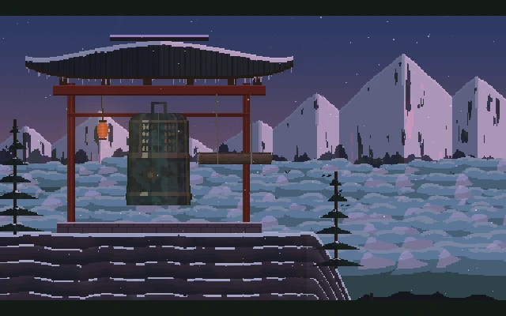

[中文](README.md) · [English](../../docs/works.en.md#bell-at-dawn) · [日本語](../../docs/works.ja.md#bell-at-dawn) · [한국어](../../docs/works.ko.md#bell-at-dawn)

# 撞钟

[▶ 在线体验](https://ma1902056219-coder.github.io/openpixel/works/bell-at-dawn/) · [源码阅读页](source.html) · [可编辑源码](source.js)

撞一下铜钟，云散开，雪落下来。

## 操作

在线打开，或下载后用浏览器打开本目录的 `index.html`。

按住撞木向右拉，然后松手。点钟身也能敲一下；打开声音能听到余音和山谷回声。

## 拆开看看

用单摆模拟撞木，把碰撞力度传给钟声、空气波纹、飞鸟与飘雪。铜钟音色由多组泛音合成。

复制这个目录，在 `source.js` 搜索 `bell` 找到作品注册，再从对应的绘制和更新函数开始。先改一个颜色或时间参数，保存后刷新观察结果。

作品在浏览器实时绘制。界面与源码注释以中文为主。作者为喵老弟 [@MarkMFFF](https://x.com/MarkMFFF)，使用和分发请保留 [MIT 许可](LICENSE)及版权声明。
