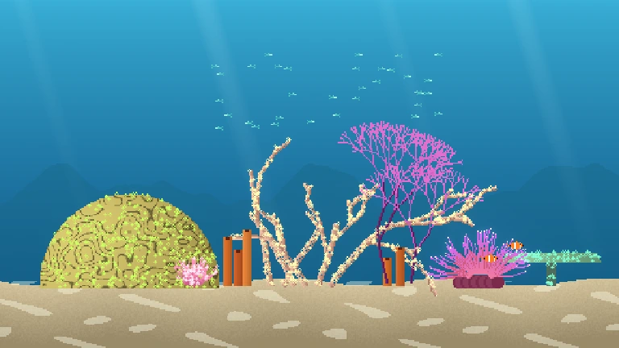

[中文](README.md) · [English](../../docs/works.en.md#coral-reef) · [日本語](../../docs/works.ja.md#coral-reef) · [한국어](../../docs/works.ko.md#coral-reef)

# 珊瑚礁

[▶ 在线体验](https://ma1902056219-coder.github.io/openpixel/works/coral-reef/) · [源码文件](source.js)

碰一下，整片珊瑚依次收起。



## 打开和操作

打开本目录的 `index.html`，或从[合集首页](../../index.html)进入。先看自动演示，再切换到手动操作。

点击珊瑚看收缩传播，按住保持；拖动制造水流；靠近海葵观察小丑鱼。

## 可以从中学什么

距离传播的收缩波、弹性摆动、鱼的避让，以及水下焦散光纹。

阳光照着的一片浅水珊瑚礁：脑珊瑚、鹿角珊瑚、一把紫色的海扇，表面布满一粒粒在进食的小珊瑚虫；一株海葵里住着两条小丑鱼，头顶游着一群蓝色的光鳃鱼，沙地上爬着光纹。 点一下珊瑚，珊瑚虫会从你手指的地方开始一圈圈合上，像波浪一样传开，然后慢慢再张开。拖动是推一股水流过去，海葵的触手、海扇和鱼都跟着倒；手伸向海葵，小丑鱼就钻进去躲起来。

## 改成自己的版本

1. 复制整个目录，编辑 `source.js`，保存后刷新 `index.html`。
2. 搜索 `reef` 定位作品注册块，再找对应模块的 `init`、`tick`、`draw`。
3. 先调整一种颜色或一个运动参数，观察变化，再添加交互。保留公共绘制、播放控件及其依赖。

```text
请阅读这个作品的 source.js，找出初始化、逐帧更新、绘制和输入处理。
先解释当前效果怎样实现，再改一组配色与一个运动参数。
保留原有操作，不添加外部素材、在线服务或新依赖。
```

[源码阅读页](source.html) · [可编辑源码](source.js) · [更多修改示例](../../docs/guide.md)

## 运行范围与许可

这是独立的实时像素效果实验，优先在桌面浏览器体验。页面与源码注释以中文为主；操作说明提供中英日韩四种语言。声音需先触发浏览器手势。本作品不需要 AI 接口、构建工具或外部资源。

原项目由 Claude 辅助编程制作。也可使用 GPT、Gemini 或其他编程助手修改，结果需要实际运行检查。

作者：喵老弟 [@MarkMFFF](https://x.com/MarkMFFF)。使用、修改和分发时按本目录 [MIT 许可](LICENSE)保留版权和许可声明。
