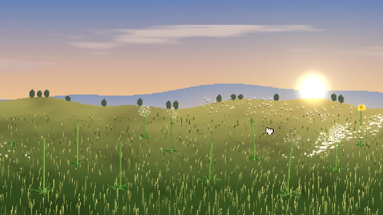

[中文](README.md) · [English](../../docs/works.en.md#dandelion) · [日本語](../../docs/works.ja.md#dandelion) · [한국어](../../docs/works.ko.md#dandelion)

# 蒲公英

吹散一朵，再长出一片。



## 打开和操作

打开本目录的 `index.html`，或从[合集首页](../../index.html)进入。先看自动演示，再切换到手动操作。

划过绒球或在旁边按住吹气；可点“快进生长”观察种子落地后的变化。

## 可以从中学什么

风场推动粒子、阻力与旋转、逆光着色，以及叶子→黄花→绒球的状态变化。

傍晚的山坡上，太阳低低地落在后面，一个个白色的蒲公英绒球被逆光照亮。手指划过去，带起的风会把种子扯下来：每一颗都是一顶小降落伞，跟着风飘、打转，慢慢沉进草里；飘过太阳的时候会被染成金色。 在绒球旁边按住不动，就是凑近对它吹气。落地的种子有的会生根：先长出一圈锯齿边的叶子，再抽出花茎、开一朵黄花，花合上以后变成一个新的绒球，又可以吹了。

## 改成自己的版本

1. 复制整个目录，编辑 `source.js`，保存后刷新 `index.html`。
2. 搜索 `dandelion` 定位作品注册块，再找对应模块的 `init`、`tick`、`draw`。
3. 先调整一种颜色或一个运动参数，观察变化，再添加交互。保留公共绘制、播放控件及其依赖。

```text
请阅读这个作品的 source.js，找出初始化、逐帧更新、绘制和输入处理。
先解释当前效果怎样实现，再改一组配色与一个运动参数。
保留原有操作，不添加外部素材、在线服务或新依赖。
```

[源码阅读页](source.html) · [可编辑源码](source.js) · [更多修改示例](../../docs/guide.md)

## 运行范围与许可

这是独立的实时像素效果实验，优先在桌面浏览器体验。页面与源码注释以中文为主；操作说明提供中英日韩四种语言。声音需先触发浏览器手势。本作品不需要 AI 接口、构建工具或外部资源。

原项目由 Claude 辅助编程制作。也可使用 GPT、Gemini 或其他编程助手修改，结果需要实际运行检查。

作者：喵老弟 [@MarkMFFF](https://x.com/MarkMFFF)。使用、修改和分发时按本目录 [MIT 许可](LICENSE)保留版权和许可声明。
