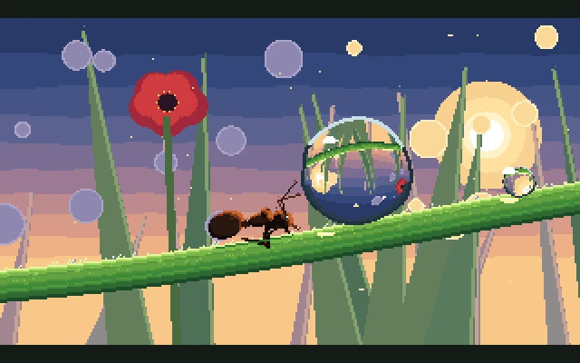

[中文](README.md) · [English](../../docs/works.en.md#dewdrop-refraction) · [日本語](../../docs/works.ja.md#dewdrop-refraction) · [한국어](../../docs/works.ko.md#dewdrop-refraction)

# 一滴露水

[▶ 在线体验](https://ma1902056219-coder.github.io/openpixel/works/dewdrop-refraction/) · [源码阅读页](source.html) · [可编辑源码](source.js)

水滴里有一朵倒过来的花。

## 操作

在线打开，或下载后用浏览器打开本目录的 `index.html`。

自动播放，约 22 秒一圈。可以暂停，再用「单帧」仔细看水滴里的倒像。

## 拆开看看

对水滴里的每个像素计算折射方向并从背景取色，再加上亮边、焦散光斑和接触时的水面形变。

复制这个目录，在 `source.js` 搜索 `dew` 找到作品注册，再从对应的绘制和更新函数开始。先改一个颜色或时间参数，保存后刷新观察结果。

作品在浏览器实时绘制。界面与源码注释以中文为主。作者为喵老弟 [@MarkMFFF](https://x.com/MarkMFFF)，使用和分发请保留 [MIT 许可](LICENSE)及版权声明。
