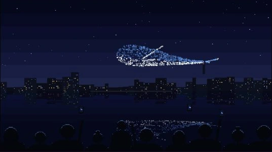

[中文](README.md) · [English](../../docs/works.en.md#drone-light-show) · [日本語](../../docs/works.ja.md#drone-light-show) · [한국어](../../docs/works.ko.md#drone-light-show)

# 千机夜空

[▶ 在线体验](https://ma1902056219-coder.github.io/openpixel/works/drone-light-show/) · [源码阅读页](source.html) · [可编辑源码](source.js)

让 1200 个光点从地球变成鲸鱼。

## 操作

在线打开，或下载后用浏览器打开本目录的 `index.html`。

点「地球」「鲸鱼」「入水」或「月亮」跳到相应片段。

## 拆开看看

在三维场景里按位置排序并配对前后目标，再给每个光点做插值。可以改成自己的粒子字、图形转场或舞台灯效。

复制这个目录，在 `source.js` 搜索 `drones` 找到作品注册，再从对应的绘制和更新函数开始。先改一个颜色或时间参数，保存后刷新观察结果。

作品在浏览器实时绘制。界面与源码注释以中文为主。作者为喵老弟 [@MarkMFFF](https://x.com/MarkMFFF)，使用和分发请保留 [MIT 许可](LICENSE)及版权声明。
