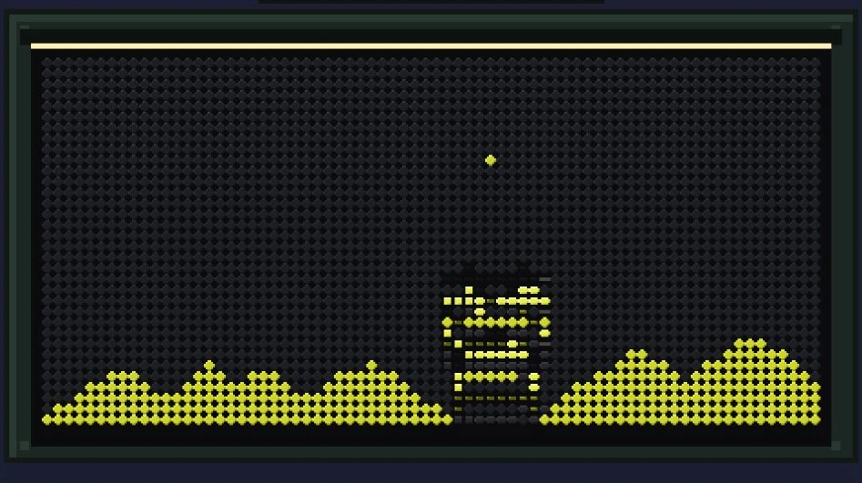

[中文](README.md) · [English](../../docs/works.en.md#flipdot-night) · [日本語](../../docs/works.ja.md#flipdot-night) · [한국어](../../docs/works.ko.md#flipdot-night)

# 翻片屏的一夜

[▶ 在线体验](https://ma1902056219-coder.github.io/openpixel/works/flipdot-night/) · [源码阅读页](source.html) · [可编辑源码](source.js)

车站关门后，站牌上的字掉下来变成沙丘。

## 操作

在线打开，或下载后用浏览器打开本目录的 `index.html`。

点「字掉下来」或「火车」跳到对应片段，打开声音听翻片咔哒声。

## 拆开看看

保留每片圆片的翻面进度和延迟，让文字逐列变化，再让翻片上的亮点参与落沙动画。可复用做机械字牌和互动海报。

复制这个目录，在 `source.js` 搜索 `flipdot` 找到作品注册，再从对应的绘制和更新函数开始。先改一个颜色或时间参数，保存后刷新观察结果。

作品在浏览器实时绘制。界面与源码注释以中文为主。作者为喵老弟 [@MarkMFFF](https://x.com/MarkMFFF)，使用和分发请保留 [MIT 许可](LICENSE)及版权声明。
