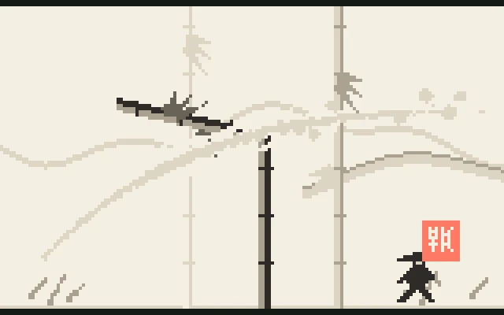

[中文](README.md) · [English](../../docs/works.en.md#ink-slash) · [日本語](../../docs/works.ja.md#ink-slash) · [한국어](../../docs/works.ko.md#ink-slash)

# 水墨斩

[▶ 在线体验](https://ma1902056219-coder.github.io/openpixel/works/ink-slash/) · [源码阅读页](source.html) · [可编辑源码](source.js)

用一笔飞白，把竹林划开。

## 操作

在线打开，或下载后用浏览器打开本目录的 `index.html`。

用「重播」看完整一笔，暂停后可逐帧检查，也可以切换背景和洋葱皮。

## 拆开看看

沿弧线绘制渐细的笔触，用分束断续做飞白，再为命中的物体补上延迟反应。

复制这个目录，在 `source.js` 搜索 `inkslash` 找到作品注册，再从对应的绘制和更新函数开始。先改一个颜色或时间参数，保存后刷新观察结果。

作品在浏览器实时绘制。界面与源码注释以中文为主。作者为喵老弟 [@MarkMFFF](https://x.com/MarkMFFF)，使用和分发请保留 [MIT 许可](LICENSE)及版权声明。
