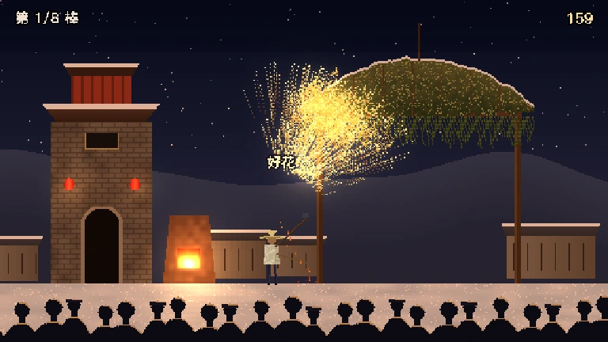

[中文](README.md) · [English](../../docs/works.en.md#iron-flower) · [日本語](../../docs/works.ja.md#iron-flower) · [한국어](../../docs/works.ko.md#iron-flower)

# 打铁花

[▶ 在线体验](https://ma1902056219-coder.github.io/openpixel/works/iron-flower/) · [源码文件](source.js)

雪夜里，一棒打出满天铁花。



## 打开和操作

打开本目录的 `index.html`，或从[合集首页](../../index.html)进入。先看自动演示，再切换到手动操作。

点击“我来玩”；按住 J 举高花棒，松开 J 击打；← → 瞄准。手机可用摇杆和按钮。

## 可以从中学什么

粒子的初速度、重力、冷却变色、二次散射，以及火光怎样照亮建筑。

正月十五的雪夜，村口搭起花棚，柳枝铺顶，挂满鞭炮。打花的人披着反穿的羊皮袄，从炉子里舀出白热的铁水。 举棒、松手、一棒打上天：铁水碎成几千颗火星，撞上柳枝又炸开一层。整个村子只有这些火星照亮。

## 改成自己的版本

1. 复制整个目录，编辑 `source.js`，保存后刷新 `index.html`。
2. 搜索 `ironflower` 定位作品注册块，再找对应模块的 `init`、`tick`、`draw`。
3. 先调整一种颜色或一个运动参数，观察变化，再添加交互。保留公共绘制、播放控件及其依赖。

```text
请阅读这个作品的 source.js，找出初始化、逐帧更新、绘制和输入处理。
先解释当前效果怎样实现，再改一组配色与一个运动参数。
保留原有操作，不添加外部素材、在线服务或新依赖。
```

[源码阅读页](source.html) · [可编辑源码](source.js) · [更多修改示例](../../docs/guide.md)

## 运行范围与许可

这是独立的实时像素效果实验，优先在桌面浏览器体验。页面与源码注释以中文为主；操作说明提供中英日韩四种语言。声音需先触发浏览器手势。本作品不需要 AI 接口、构建工具或外部资源。

原项目由 Claude 辅助编程制作。也可使用 GPT、Gemini 或其他编程助手修改，结果需要实际运行检查。

作者：喵老弟 [@MarkMFFF](https://x.com/MarkMFFF)。使用、修改和分发时按本目录 [MIT 许可](LICENSE)保留版权和许可声明。
