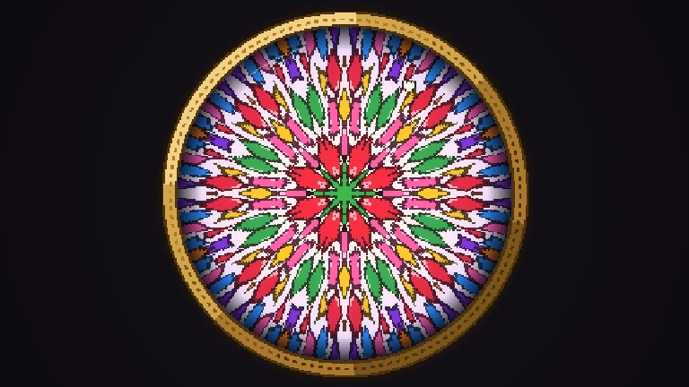

[中文](README.md) · [English](../../docs/works.en.md#kaleidoscope) · [日本語](../../docs/works.ja.md#kaleidoscope) · [한국어](../../docs/works.ko.md#kaleidoscope)

# 万花筒

转一下，就得到一朵新图案。



## 打开和操作

打开本目录的 `index.html`，或从[合集首页](../../index.html)进入。先看自动演示，再切换到手动操作。

按住绕圈拖动旋转镜筒，点击中心摇晃；下方可切换花瓣数和材料。

## 可以从中学什么

扇区镜像、旋转坐标、碎片碰撞与重力，以及透明颜色的叠加。

从黄铜镜筒里往外看。筒底的小室里装着彩色碎玻璃、珠子和亮片，它们在重力下滚来滚去；两面镜子把其中一小块折成一整朵花。按住绕圈拖动就是转镜筒，“下”的方向跟着转，碎片就滑落、翻滚，花就一刻不停地变成新的样子。 碎片是一个个有重量的小东西，会互相碰撞、滚动，相撞时叮叮响；两片玻璃叠在一起时颜色相乘，更深更浓，就像真的彩色玻璃透光。可以换镜子数量（8 到 24 瓣），也可以换一筒：碎玻璃、珠子亮片、压干的花瓣。

## 改成自己的版本

1. 复制整个目录，编辑 `source.js`，保存后刷新 `index.html`。
2. 搜索 `kaleido` 定位作品注册块，再找对应模块的 `init`、`tick`、`draw`。
3. 先调整一种颜色或一个运动参数，观察变化，再添加交互。保留公共绘制、播放控件及其依赖。

```text
请阅读这个作品的 source.js，找出初始化、逐帧更新、绘制和输入处理。
先解释当前效果怎样实现，再改一组配色与一个运动参数。
保留原有操作，不添加外部素材、在线服务或新依赖。
```

[源码阅读页](source.html) · [可编辑源码](source.js) · [更多修改示例](../../docs/guide.md)

## 运行范围与许可

这是独立的实时像素效果实验，优先在桌面浏览器体验。页面与源码注释以中文为主；操作说明提供中英日韩四种语言。声音需先触发浏览器手势。本作品不需要 AI 接口、构建工具或外部资源。

原项目由 Claude 辅助编程制作。也可使用 GPT、Gemini 或其他编程助手修改，结果需要实际运行检查。

作者：喵老弟 [@MarkMFFF](https://x.com/MarkMFFF)。使用、修改和分发时按本目录 [MIT 许可](LICENSE)保留版权和许可声明。
