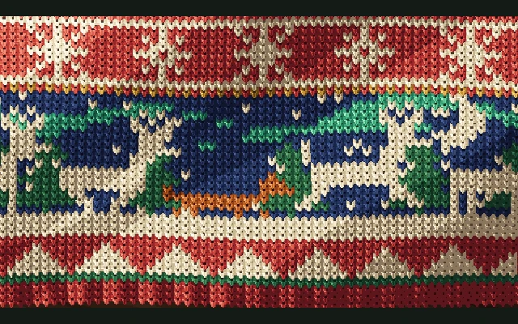

[中文](README.md) · [English](../../docs/works.en.md#living-knit) · [日本語](../../docs/works.ja.md#living-knit) · [한국어](../../docs/works.ko.md#living-knit)

# 会动的毛衣

[▶ 在线体验](https://ma1902056219-coder.github.io/openpixel/works/living-knit/) · [源码阅读页](source.html) · [可编辑源码](source.js)

一针针织出来，图案里的鹿跑了起来。

## 操作

在线打开，或下载后用浏览器打开本目录的 `index.html`。

点「起针」「织到一半」「活过来」或「猫」，跳到对应片段。

## 拆开看看

把针脚当作渲染单元，给线圈加股纹、绒毛和褶皱，再用时间轴控制织入与拆线。

复制这个目录，在 `source.js` 搜索 `knit` 找到作品注册，再从对应的绘制和更新函数开始。先改一个颜色或时间参数，保存后刷新观察结果。

作品在浏览器实时绘制。界面与源码注释以中文为主。作者为喵老弟 [@MarkMFFF](https://x.com/MarkMFFF)，使用和分发请保留 [MIT 许可](LICENSE)及版权声明。
