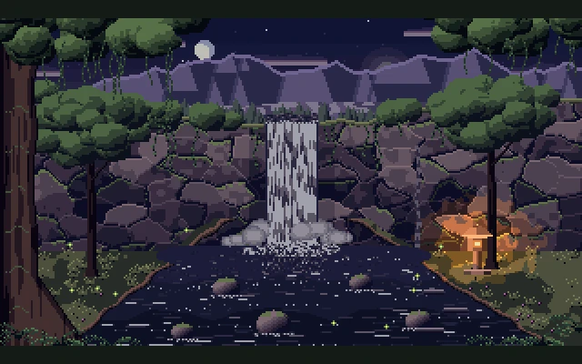

[中文](README.md) · [English](../../docs/works.en.md#palette-waterfall) · [日本語](../../docs/works.ja.md#palette-waterfall) · [한국어](../../docs/works.ko.md#palette-waterfall)

# 色彩循环瀑布

[▶ 在线体验](https://ma1902056219-coder.github.io/openpixel/works/palette-waterfall/) · [源码阅读页](source.html) · [可编辑源码](source.js)

像素编号不动，瀑布却在流。

## 操作

在线打开，或下载后用浏览器打开本目录的 `index.html`。

点「显示调色板」看颜色轮换，用「时间」切换清晨、白天、黄昏和夜晚。

## 拆开看看

用索引色绘制背景，再轮换指定的颜色区间。可用在水流、雾、灯光和昼夜切换。

复制这个目录，在 `source.js` 搜索 `cycle` 找到作品注册，再从对应的绘制和更新函数开始。先改一个颜色或时间参数，保存后刷新观察结果。

作品在浏览器实时绘制。界面与源码注释以中文为主。作者为喵老弟 [@MarkMFFF](https://x.com/MarkMFFF)，使用和分发请保留 [MIT 许可](LICENSE)及版权声明。
