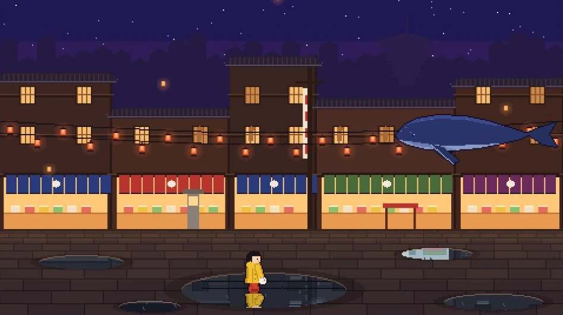

[中文](README.md) · [English](../../docs/works.en.md#puddle-worlds) · [日本語](../../docs/works.ja.md#puddle-worlds) · [한국어](../../docs/works.ko.md#puddle-worlds)

# 水洼倒影

[▶ 在线体验](https://ma1902056219-coder.github.io/openpixel/works/puddle-worlds/) · [源码阅读页](source.html) · [可编辑源码](source.js)

镜头跳进水洼，翻到另一条街。

## 操作

在线打开，或下载后用浏览器打开本目录的 `index.html`。

从「雨夜这边」开始，点「跳进水洼」接近转场；想先看另一条街，可以点「灯笼那边」。

## 拆开看看

同时绘制两个世界，用水洼形状裁切和扭曲倒影，再通过镜头下沉与翻转交换两个场景。可用于门户、镜面和场景转场。

复制这个目录，在 `source.js` 搜索 `puddle` 找到作品注册，再从对应的绘制和更新函数开始。先改一个颜色或时间参数，保存后刷新观察结果。

作品在浏览器实时绘制。界面与源码注释以中文为主。作者为喵老弟 [@MarkMFFF](https://x.com/MarkMFFF)，使用和分发请保留 [MIT 许可](LICENSE)及版权声明。
