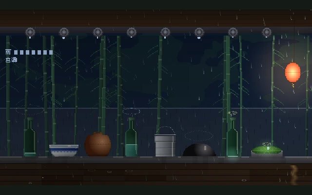

[中文](README.md) · [English](../../docs/works.en.md#rain-instrument) · [日本語](../../docs/works.ja.md#rain-instrument) · [한국어](../../docs/works.ko.md#rain-instrument)

# 雨的乐器

[▶ 在线体验](https://ma1902056219-coder.github.io/openpixel/works/rain-instrument/) · [源码阅读页](source.html) · [可编辑源码](source.js)

把瓶瓶罐罐挪到屋檐下，让雨来演奏。

## 操作

在线打开，或下载后用浏览器打开本目录的 `index.html`。

点画面启用声音，敲一敲器皿，再拖到另一条滴水线上。在天空横拖调节雨量。

## 拆开看看

用雨滴碰撞触发音符，通过 Web Audio 合成材质各异的声音，并把水位映射成音高。

复制这个目录，在 `source.js` 搜索 `rainmusic` 找到作品注册，再从对应的绘制和更新函数开始。先改一个颜色或时间参数，保存后刷新观察结果。

作品在浏览器实时绘制。界面与源码注释以中文为主。作者为喵老弟 [@MarkMFFF](https://x.com/MarkMFFF)，使用和分发请保留 [MIT 许可](LICENSE)及版权声明。
