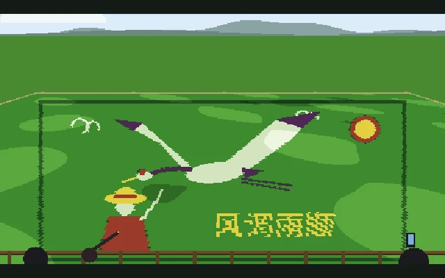

[中文](README.md) · [English](../../docs/works.en.md#rice-field-perspective) · [日本語](../../docs/works.ja.md#rice-field-perspective) · [한국어](../../docs/works.ko.md#rice-field-perspective)

# 稻田画

[▶ 在线体验](https://ma1902056219-coder.github.io/openpixel/works/rice-field-perspective/) · [源码阅读页](source.html) · [可编辑源码](source.js)

从田埂上看是色块，登塔才看见一只鹤。

## 操作

在线打开，或下载后用浏览器打开本目录的 `index.html`。

依次点「田埂上」「爬上塔」「正上方」。也可以跳到插秧、稻浪和收割。

## 拆开看看

从指定视点把图案反投影到地面网格，再让镜头沿不同路线移动。这套思路也能做地面画、视角谜题和舞台投影。

复制这个目录，在 `source.js` 搜索 `paddy` 找到作品注册，再从对应的绘制和更新函数开始。先改一个颜色或时间参数，保存后刷新观察结果。

作品在浏览器实时绘制。界面与源码注释以中文为主。作者为喵老弟 [@MarkMFFF](https://x.com/MarkMFFF)，使用和分发请保留 [MIT 许可](LICENSE)及版权声明。
