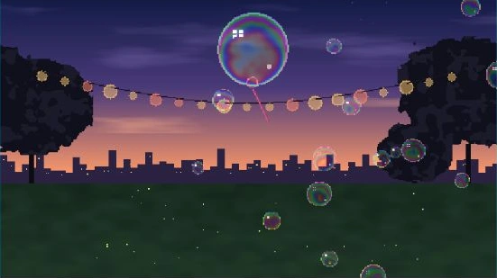

[中文](README.md) · [English](../../docs/works.en.md#soap-film) · [日本語](../../docs/works.ja.md#soap-film) · [한국어](../../docs/works.ko.md#soap-film)

# 肥皂泡

[▶ 在线体验](https://ma1902056219-coder.github.io/openpixel/works/soap-film/) · [源码阅读页](source.html) · [可编辑源码](source.js)

吹出一个泡泡，看彩膜流动到破裂。

## 操作

在线打开，或下载后用浏览器打开本目录的 `index.html`。

按住慢慢拖，松手放飞大泡泡。快甩出一串小泡泡，点泡泡可以戳破。

## 拆开看看

用膜厚变化和视角来模拟薄膜干涉，再叠加流动纹路和破裂粒子。可改成彩虹膜、魔法罩等效果。

复制这个目录，在 `source.js` 搜索 `bubble` 找到作品注册，再从对应的绘制和更新函数开始。先改一个颜色或时间参数，保存后刷新观察结果。

作品在浏览器实时绘制。界面与源码注释以中文为主。作者为喵老弟 [@MarkMFFF](https://x.com/MarkMFFF)，使用和分发请保留 [MIT 许可](LICENSE)及版权声明。
