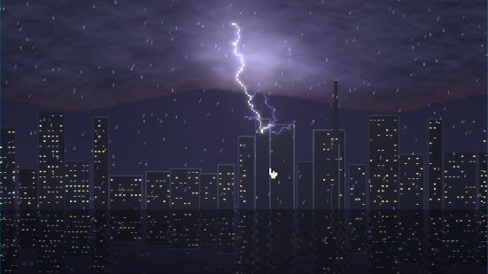

[中文](README.md) · [English](../../docs/works.en.md#storm-lightning) · [日本語](../../docs/works.ja.md#storm-lightning) · [한국어](../../docs/works.ko.md#storm-lightning)

# 雷暴

[▶ 在线体验](https://ma1902056219-coder.github.io/openpixel/works/storm-lightning/) · [源码阅读页](source.html) · [可编辑源码](source.js)

画一条线，松手劈出闪电。

## 操作

在线打开，或下载后用浏览器打开本目录的 `index.html`。

从云层按住往下拖，松手看闪电。也可以按住云层蓄电，等它自动释放。

## 拆开看看

把输入轨迹变成闪电主干，沿主干生成分枝，再把闪光、倒影和楼窗变化放到同一条时间线上。

复制这个目录，在 `source.js` 搜索 `storm` 找到作品注册，再从对应的绘制和更新函数开始。先改一个颜色或时间参数，保存后刷新观察结果。

作品在浏览器实时绘制。界面与源码注释以中文为主。作者为喵老弟 [@MarkMFFF](https://x.com/MarkMFFF)，使用和分发请保留 [MIT 许可](LICENSE)及版权声明。
