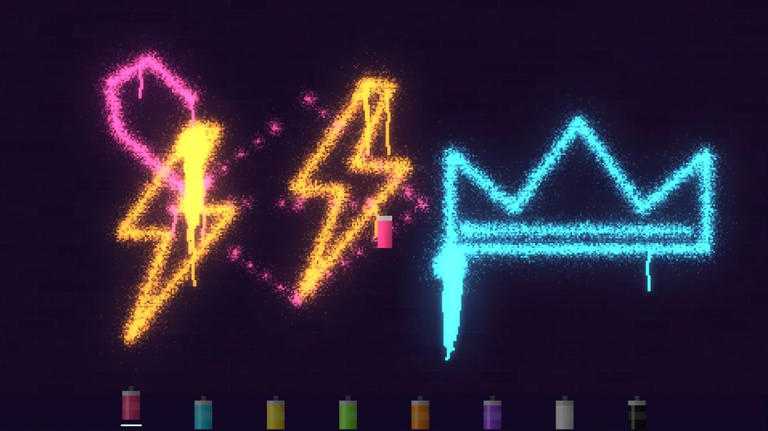

[中文](README.md) · [English](../../docs/works.en.md#uv-graffiti) · [日本語](../../docs/works.ja.md#uv-graffiti) · [한국어](../../docs/works.ko.md#uv-graffiti)

# 喷漆

[▶ 在线体验](https://ma1902056219-coder.github.io/openpixel/works/uv-graffiti/) · [源码阅读页](source.html) · [可编辑源码](source.js)

在砖墙画一笔，换成紫外灯就会亮。

## 操作

在线打开，或下载后用浏览器打开本目录的 `index.html`。

点地上的罐子换色，拖动喷漆，按住会积漆流下来。点「灯：路灯」切换紫外灯。

## 拆开看看

把飞沫、砖面吸收和积漆分开计算，再用单独的发光层表现荧光。可以改成画板、贴花或游戏里的可绘制表面。

复制这个目录，在 `source.js` 搜索 `spray` 找到作品注册，再从对应的绘制和更新函数开始。先改一个颜色或时间参数，保存后刷新观察结果。

作品在浏览器实时绘制。界面与源码注释以中文为主。作者为喵老弟 [@MarkMFFF](https://x.com/MarkMFFF)，使用和分发请保留 [MIT 许可](LICENSE)及版权声明。
