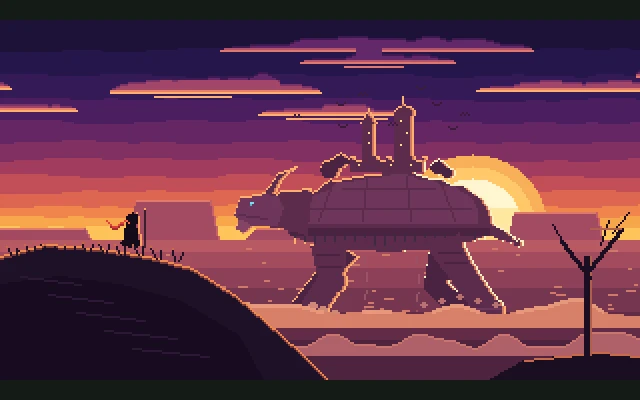

[中文](README.md) · [English](../../docs/works.en.md#walking-colossus) · [日本語](../../docs/works.ja.md#walking-colossus) · [한국어](../../docs/works.ko.md#walking-colossus)

# 巨像

[▶ 在线体验](https://ma1902056219-coder.github.io/openpixel/works/walking-colossus/) · [源码阅读页](source.html) · [可编辑源码](source.js)

一头石兽，背着整座古城从夕阳前走过。

## 操作

在线打开，或下载后用浏览器打开本目录的 `index.html`。

自动播放，一趟约一分钟。用 2× 快速找到巨兽经过夕阳的位置，再暂停或逐帧观看。

## 拆开看看

用反向运动学控制四条腿，根据脚掌落地触发尘土与震动，再用逆光和远近图层表现体积。

复制这个目录，在 `source.js` 搜索 `colossus` 找到作品注册，再从对应的绘制和更新函数开始。先改一个颜色或时间参数，保存后刷新观察结果。

作品在浏览器实时绘制。界面与源码注释以中文为主。作者为喵老弟 [@MarkMFFF](https://x.com/MarkMFFF)，使用和分发请保留 [MIT 许可](LICENSE)及版权声明。
